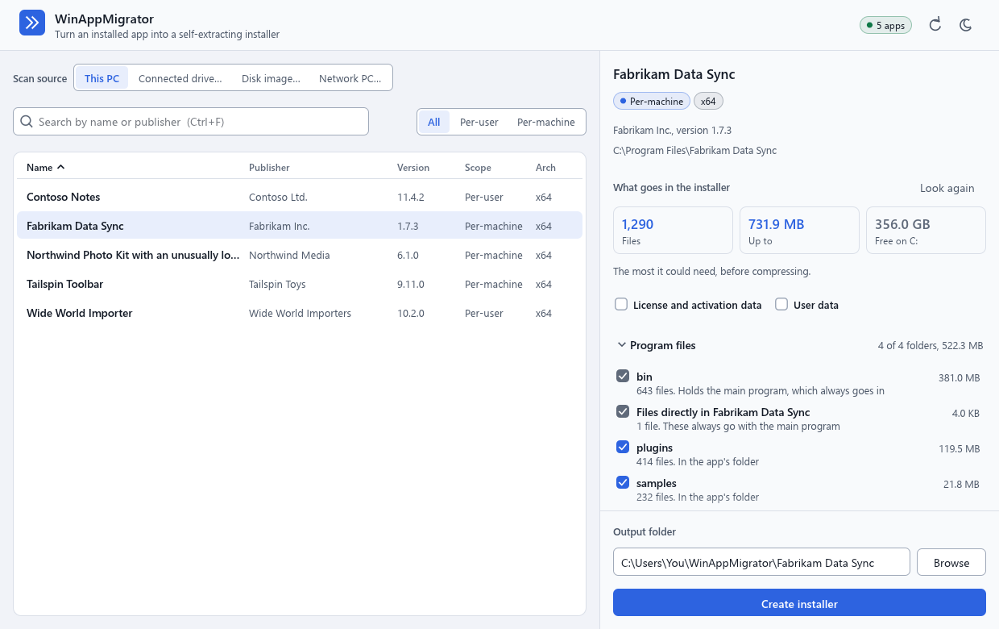
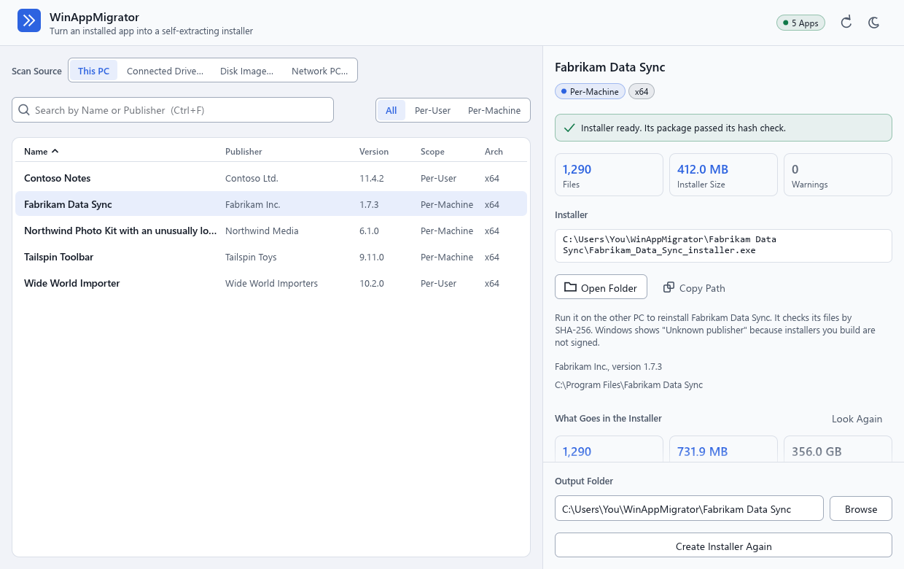
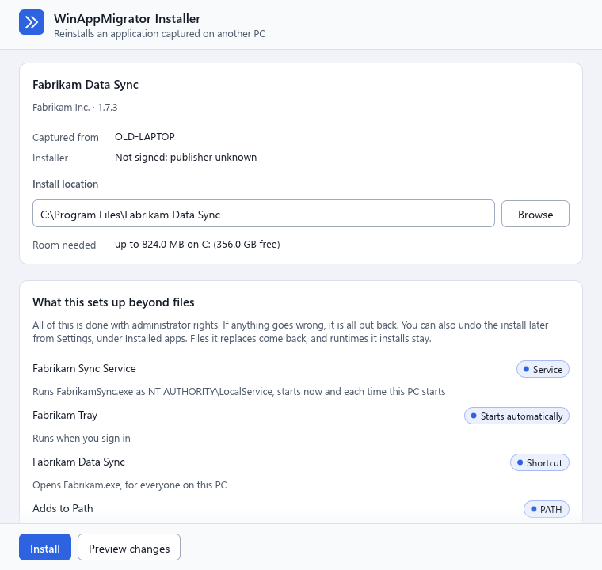

<p align="center">
  
</p>

<h1 align="center">WinAppMigrator</h1>

<p align="center">
  <strong>Turn an installed Windows app into one installer you can run on another PC.</strong><br>
  Even when the app came from a drive pulled out of a dying machine, and the original installer is long gone.
</p>

<p align="center">
  <a href="https://github.com/RandyNorthrup/WinAppMigrator/releases/latest"></a>
  <a href="https://github.com/RandyNorthrup/WinAppMigrator/releases"></a>
  <a href="https://github.com/RandyNorthrup/WinAppMigrator/stargazers"></a>
  <a href="https://github.com/RandyNorthrup/WinAppMigrator/actions/workflows/ci.yml"></a>
  
  
  <a href="LICENSE"></a>
</p>

<p align="center">
  <a href="https://github.com/RandyNorthrup/WinAppMigrator/releases/latest"><strong>Download</strong></a> ·
  <a href="#how-it-works">How it works</a> ·
  <a href="#what-gets-captured">What gets captured</a> ·
  <a href="#limitations">Limitations</a> ·
  <a href="#documentation">Docs</a>
</p>

<p align="center">
  <picture>
    <source media="(prefers-color-scheme: dark)" srcset="docs/images/app-pick-dark.png">
    
  </picture>
</p>

## Why

Reinstalling software on a new PC usually means hunting down installers, license files, and
settings. Sometimes the installer no longer exists, the vendor is gone, or the old PC will not boot.
WinAppMigrator works backward from what is installed: it finds the app's files, registry entries,
services, and runtimes, and packs them into a single `.exe`.

- **One file.** The app is one portable `.exe`, and so is every installer it builds.
- **Works from a pulled drive.** Connect the disk from a failed PC and pick an app from it.
- **Brings the runtimes along.** The Visual C++ runtime is downloaded when you build and embedded, so it
  installs without internet.
- **Checks its work.** The installer checks its package's hashes before writing anything, then checks
  the files it installed.
- **Previews first.** See what would change before installing.

## How it works

Download `WinAppMigrator-<version>.exe` from the
[latest release](https://github.com/RandyNorthrup/WinAppMigrator/releases/latest) and run it. There
is nothing to install. Windows asks for administrator approval, because reading another drive and
installing services both need it.

### 1. Pick an app

Choose **This PC** or **Connected drive…**, then search or sort the list. Optionally include the
app's license data and user data.

### 2. Build the installer

Follow the progress, or cancel. You get one file, named after what it contains, such as
`Fabrikam_Data_Sync_userdata_license_installer.exe`.

<p align="center">
  <picture>
    <source media="(prefers-color-scheme: dark)" srcset="docs/images/app-done-dark.png">
    
  </picture>
</p>

### 3. Run it on the other PC

Copy the installer over and run it. Check the install location, preview the changes if you like, then
click **Install**.

<p align="center">
  <picture>
    <source media="(prefers-color-scheme: dark)" srcset="docs/images/installer-dark.png">
    
  </picture>
</p>

<sub>Screenshots use sample data, and follow your GitHub theme. The app has light and dark modes, and an
installer opens in the theme it was built with.</sub>

## What gets captured

| | Included | Notes |
| --- | --- | --- |
| **Program files** | Always | Found through MSI and Inno Setup records, NSIS logs, App Paths, and folders named exactly for the product |
| **Registry** | Always | The app's keys, plus COM and file associations pointing at it |
| **Services and drivers** | Always | Drivers the app owns are re-registered. Vendor and inbox drivers are reported instead, because they cannot be redistributed |
| **Scheduled tasks, shortcuts, environment variables** | Always | A captured `Path` is merged into the target's, never replaced |
| **Runtimes** | Always | Visual C++ is embedded, or comes through winget if its download failed at build time. .NET comes through winget or a Windows feature, or is part of Windows already, so it can need internet on the target |
| **User data** | Your choice | AppData, ProgramData, Documents, and Saved Games. Online-only OneDrive files are skipped |
| **License data** | Your choice | License files and stores. Reports whether each is likely tied to the machine. [Never bypasses activation](SECURITY.md#licensing-data) |

## Limitations

Please read these before relying on it, especially on a one-way trip from a failing PC.

- **It can miss what is kept under another name.** Beyond what the install records name, folders and
  registry keys are matched by the product's exact name, so data under a different name stays behind.
  Check the file count and size on the result. If they look wrong, don't rely on that installer.
- **An app made of several packages only gets its own.** NVIDIA App's `NvContainer` is a separate package,
  for example, so an installer built from NVIDIA App alone does not have it.
- **An installer cannot reach 4 GiB.** Windows cannot start an executable that large, so the build fails
  and says so. Large apps may not fit.
- **Installs have no rollback, and no uninstaller is created.** A failure can leave an install part-way,
  and files with the same names are replaced. The window warns you if the folder already has files.
- **Building from a connected drive captures less than building from the running PC.** COM, file
  associations, Run keys, and environment variables often do not match, shortcuts are not recreated, and
  the default install location keeps the drive's letter, so change it. Windows may also write to a
  drive's registry files while loading them, so **image a failing drive first** and scan the image.
- **Some things are not captured:** URL protocols, shell extensions, firewall rules, fonts, certificates,
  and ODBC sources. Microsoft Store apps are not listed.
- **Documents and Saved Games** restore under the install folder, not your user folders. AppData and
  ProgramData go to their real locations.
- **Hash checks have limits.** Driver images and license stores are only checked for presence, and a file
  that could not be read during the scan is checked by size only. A preview checks no hashes, and its
  window lists the first 300 changes, with files first, so on a larger app the registry, service, and task
  changes are not listed.
- **Some licenses will not move.** Anything tied to the old machine may need reactivating.
- **It is only for software you are licensed to move.** That part is up to you.

The full list, with planned fixes, is in the [plan](docs/PLAN.md#open-issues-most-important-first).

## Security and signing

- **Only run installers you trust.** An installer runs elevated and does what its package says. Its hash
  checks catch damage, not tampering.
- **An installer can contain secrets.** It copies what the app keeps in its folders and registry keys,
  which can include license keys and tokens, even with the License option off. Share one accordingly.
- **Signing.** Starting with the next release, the app is signed (publisher: Randy Northrup), and each
  release records build provenance you can check with `gh attestation verify`. Current downloads are
  unsigned. Installers you build are not signed unless you sign them, so Windows shows "Unknown
  publisher" for them. [Why, and how to sign one](docs/signing.md).

More in [SECURITY.md](SECURITY.md).

## Automating the installer

Run with any argument, an installer skips its window. With `--target-root` it previews unless you pass
`--apply`, and exits non-zero if anything fails to verify. Without `--target-root` it prints usage.

```powershell
# Preview
.\App_installer.exe --target-root "C:\Program Files\App"

# Install
.\App_installer.exe --target-root "C:\Program Files\App" --apply --force
```

| Flag | Effect |
| --- | --- |
| `--target-root <DIR>` | Where to install. Must be a full path |
| `--apply` | Actually install. Without it nothing is installed: the package is unpacked to a temporary folder, which is then removed |
| `--dry-run` | Preview, stated explicitly |
| `--force` | Replace existing files, registry values, services, tasks, shortcuts, and environment variables |
| `--restore-user-data` | Put user data in the real AppData and ProgramData folders, not under the target |
| `--no-restore-license` | Skip captured license data, which is otherwise restored |

Pipe the output somewhere to read it, for example `| Out-String`. The installer is a windowed program, so
it does not write to an interactive console. Automation still needs an elevated shell, because the
installer demands elevation.

## Building from source

You need Windows 10 or 11, the [Rust](https://rustup.rs) stable toolchain (1.96 or newer), and the Visual
Studio C++ build tools. The app carries the installer inside itself, so build the installer first:

```powershell
cargo build --release -p winappmigrator-installer
$env:WINAPPMIGRATOR_INSTALLER_STUB = "$PWD\target\release\winappmigrator-installer.exe"
cargo build --release -p winappmigrator-gui
.\target\release\winappmigrator.exe
```

| Crate | What it is |
| --- | --- |
| [`winappmigrator-core`](crates/winappmigrator-core) | Discovery, packaging, restore, and verification |
| [`winappmigrator-ui`](crates/winappmigrator-ui) | Shared design system, widgets, and process hardening |
| [`winappmigrator-gui`](crates/winappmigrator-gui) | The app, built as `winappmigrator.exe`. Never restores anything |
| [`winappmigrator-installer`](crates/winappmigrator-installer) | The stub inside every installer. Restore lives only here |

Run the checks with the commands in [CONTRIBUTING.md](CONTRIBUTING.md). Releases are built by
[GitHub Actions](.github/workflows/release.yml) when a `v*` tag is pushed.

## Documentation

| | |
| --- | --- |
| [Discovery](docs/discovery.md) | How an app's footprint is found, and from a connected drive |
| [Interface](docs/gui.md) | How the screens are built, and the design conventions |
| [Signing](docs/signing.md) | What is signed, what must never be, and how |
| [Plan](docs/PLAN.md) | Scope, and open issues in priority order |
| [Security](SECURITY.md) | The trust model, and how to report a vulnerability |
| [Contributing](CONTRIBUTING.md) | The project's rules and checks |
| [Changelog](CHANGELOG.md) | What changed in each release |

## License and support

[MIT](LICENSE) © 2026 Randy Northrup. Third-party attributions are in
[THIRD-PARTY-LICENSES.md](THIRD-PARTY-LICENSES.md).

If this saves you time, you can [buy me a coffee](https://www.paypal.com/donate/?hosted_button_id=Q9VC7B42R7K82)
or [sponsor on GitHub](https://github.com/sponsors/RandyNorthrup). Thank you!
