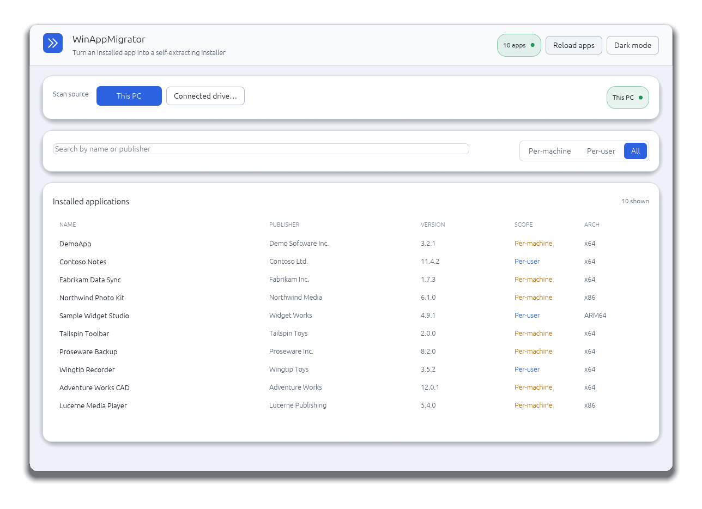
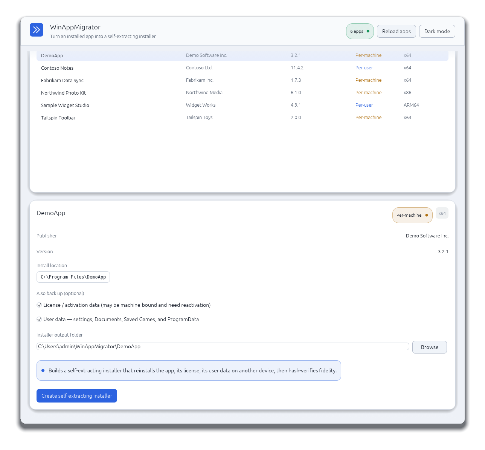
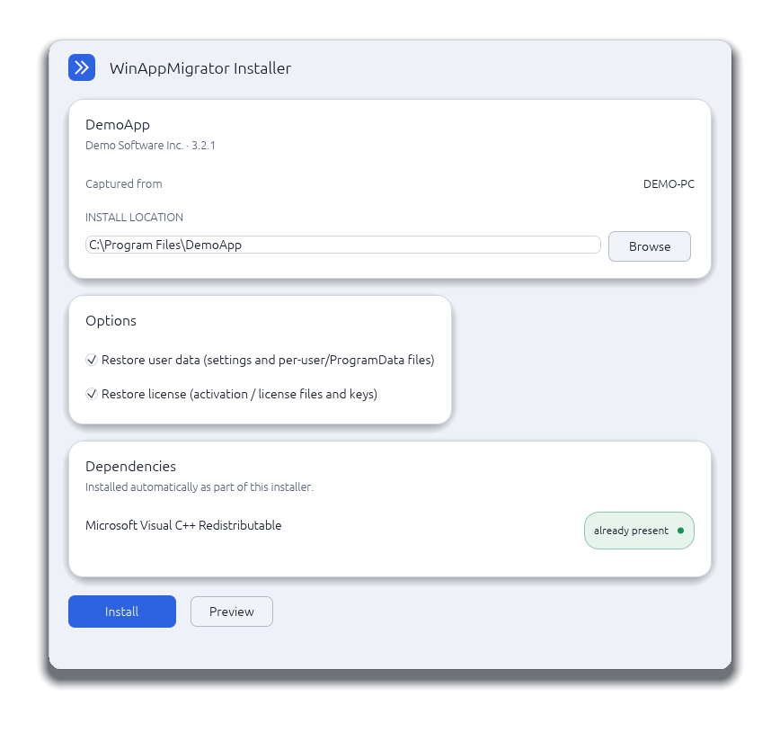

# WinAppMigrator

WinAppMigrator is a Windows 10/11 desktop app that backs up an installed
application into a single **self-extracting installer**. You pick an installed
app — on this PC **or on a drive from another (often failing) PC** — optionally
include its license and its user data, and the app reverse-engineers the
application's full on-disk footprint and Windows integrations and writes one
`.exe`. Run that `.exe` on another machine and it reinstalls the app (plus the
bundled license/user data), then hash-verifies every file.

Author: **Randy Northrup**.

## Screenshots

Turn an installed app into one self-extracting installer in three steps —
**pick → build → install**. _(Shown with a sample “DemoApp”.)_

**1. Pick an installed app** — on this PC or a drive from another PC.



**2. Choose what to back up and build the installer** — optionally include the
app's license and user data, then produce a single `.exe`.



**3. Run the installer on the target PC** — it reinstalls the app (in the same
theme it was built with), restores the captured data, and hash-verifies every file.



## Two binaries, one job each

- **`winappmigrator-gui` — the app** (binary `winappmigrator.exe`). Runs on the
  source machine. Lists installed apps and builds the installer. It **never
  restores** anything.
- **`winappmigrator-installer` — the installer stub** (binary
  `winappmigrator-installer.exe`). Compiled once and **embedded inside the app**
  (`include_bytes!`), so WinAppMigrator ships as a single portable executable.
  Each installer the app produces is this stub with the application's package
  appended. It runs on the target machine and performs the reinstall + hash
  verification. **Restore lives only here.**

Both binaries **always run elevated**: each embeds a `requireAdministrator`
manifest, so Windows prompts once via UAC at launch and the whole session is
elevated — there is no mid-task elevation prompt.

## How it works

**Footprint discovery is layered.** It detects *how* an app was installed and
reads the authoritative installed paths where Windows records them (Windows
Installer/MSI component database; Inno Setup `unins*.dat`; NSIS `uninstall.log`;
App Paths), then completes the picture with a conservative scan of `Program
Files`, `Program Files (x86)`, `ProgramData`, per-user `AppData`
(Roaming/Local/LocalLow), `Documents`/`Saved Games` (following OneDrive/folder
redirection), and shared `Public\Documents`, including nested `Vendor\App`
layouts. It also captures registry keys, services, drivers, scheduled tasks,
shortcuts, environment variables, COM/file associations, and runtime
prerequisites. See [docs/discovery.md](docs/discovery.md).

**Scan source: this PC or a connected drive.** Every scanner reads state through
one `SystemContext` seam (`ScanSource::{Live, OfflineVolume}`). For a disk pulled
from another PC and mounted here (e.g. `E:\`), the app mounts that disk's registry
hives read-only (`reg load`, using backup privilege so ACL-locked hives read
non-destructively), reads scheduled tasks straight from the on-disk Task XML, and
re-roots recorded paths (`C:\…` → `E:\…`). Reading a foreign disk is strictly
non-destructive — the source is only ever read (backup-mode reads; never
`takeown`/`icacls`).

**The GUI** is an `eframe`/`egui` single-screen app with a light/dark design
system; see [docs/gui.md](docs/gui.md).

## Workspace

Rust workspace, edition 2024, current stable toolchain:

- **`winappmigrator-core`** — shared domain logic: inventory, install-source
  reverse-engineering, footprint discovery, packaging, restore, verification, and
  the `SystemContext` live/offline seam.
- **`winappmigrator-ui`** — shared `egui` design system (`theme`) and widgets,
  reused by both the app and the produced installer so they render identically.
- **`winappmigrator-gui`** — the app (binary `winappmigrator`).
- **`winappmigrator-installer`** — the self-extracting installer stub, embedded
  into the app.

Key dependencies: `winreg` (uninstall inventory, MSI component database, App
Paths, offline hive access), `pelite` (PE metadata/imports), `roxmltree` (offline
scheduled-task XML), `walkdir` (bounded discovery), `sha2` (streaming SHA-256),
`filetime` (timestamp preservation), `zip` (package archives + self-extraction),
`tempfile`, `serde`/`serde_json` (reports), `ureq`/`native-tls` (prerequisite
downloads), `eframe`/`rfd` (GUI), `tracing` (diagnostics).

## Requirements

- Windows 10 or Windows 11
- Rust stable toolchain with the MSVC target
- Optional local security tools this repo supports: `cargo audit`, `cargo deny`

Building requires no elevation. **Running** the app or a produced installer
triggers a UAC prompt (both embed a `requireAdministrator` manifest). No
environment variables are required.

## Building an installer (the app)

Launch the app on the source machine (a UAC prompt appears — the app runs
elevated):

```powershell
cargo run -p winappmigrator-gui
```

The app is a single screen:

1. **Pick a scan source** — *This PC* (default) or *Connected drive…* (the root
   of a disk from another machine).
2. **Pick an installed app** from the searchable table (filter by All / Per-user
   / Per-machine). Selecting a row detects its install method, reverse-engineers
   its footprint, and prefills a default output folder.
3. **Optionally include** the app's license/activation data and/or its user data
   (settings, Documents, Saved Games, ProgramData) with two toggles. Program
   files are always included.
4. **Create the self-extracting installer.** Building reverse-engineers the app,
   copies its files and the selected data, embeds everything in one `.exe`, and
   hash-verifies the package. The result card shows the installer path and a
   "Hashes confirmed" status.

The produced installer is **named after the application** (not the output
folder), with a suffix encoding what it carries — e.g.
`YAMAHA DIAGNOSTIC SYSTEM2_userdata_license_installer.exe`. The app never restores
anything; it only builds and confirms the package's own hashes.

Release binaries are written to `target\release\winappmigrator.exe` (the app,
with the stub embedded) and `target\release\winappmigrator-installer.exe` (the
bare stub).

## Running a produced installer (the target)

Copy the produced `<App>…_installer.exe` to the target machine and run it (it
elevates via UAC). Double-clicked, it opens a window showing the app, an editable
**install location**, **Restore user data** / **Restore license** checkboxes
(shown only when those were captured at build time), and a **Dependencies** plan,
then installs with live progress and post-install hash verification.

Given command-line arguments it runs **headlessly** instead — the flow used by
automation and the end-to-end test:

```powershell
# Preview the reinstall (default):
.\App_installer.exe --target-root "C:\Program Files\App"

# Reinstall:
.\App_installer.exe --target-root "C:\Program Files\App" --apply --force
```

Headless flags: `--target-root <DIR>`, `--dry-run`, `--apply`, `--force`,
`--restore-user-data`, `--no-restore-license`.

By default, packaged per-user/ProgramData data is staged under the target root
(`<target-root>\…`). Add `--restore-user-data` to instead reinstall it into the
target machine's real `%AppData%`/`%LocalAppData%`/LocalLow/`%ProgramData%`
locations. License restore is on by default; opt out with `--no-restore-license`.
The installer **verifies as part of installing** — it hash-checks its package and
the reinstalled files and exits non-zero on any mismatch.

Package contents (inside the embedded payload): `manifest.json`,
`restore_plan.md`, `reports\*`, `files\*`,
registry/service/driver/task/shortcut/environment artifacts, and optional
`license\*`. The installer writes `verification_report.json` / `.md` during its
hash check.

## Development

```powershell
cargo fmt
cargo fmt --check
cargo check --workspace --all-targets --all-features   # alias: cargo typecheck
cargo test --workspace --all-targets --all-features    # alias: cargo quality
cargo clippy --workspace --all-targets --all-features -- -D warnings
cargo build --workspace --release
cargo audit
cargo deny check
```

The whole pipeline is exercised end-to-end by
[`crates/winappmigrator-installer/tests/installer_e2e.rs`](crates/winappmigrator-installer/tests/installer_e2e.rs):
it reverse-engineers a real executable, builds the self-extracting installer with
the actual stub, runs that installer against a clean target directory, and asserts
the reinstall plus hash verification pass. Because the installer requires
elevation, that reinstall step runs from an **elevated shell** (CI runs elevated);
on a non-elevated host it skips cleanly. The `winappmigrator-core` suite covers
footprint discovery, packaging, self-extraction, restore, and verification at unit
level.

## CI and releases

- **CI** ([.github/workflows/ci.yml](.github/workflows/ci.yml)) runs on
  `windows-latest` for every push/PR to `main`: format check, typecheck, tests,
  clippy with warnings denied, `cargo audit`, `cargo deny check`, and a release
  build.
- **Releases** ([.github/workflows/release.yml](.github/workflows/release.yml))
  run when a `v*` tag is pushed (or via manual dispatch). They build the installer
  stub then the app (so the app embeds the fresh stub) and publish a GitHub
  Release with `winappmigrator.exe`, a portable `.zip`, and `SHA256SUMS.txt`.

The current version is `0.4.2` (latest release `v0.4.2.1`). Builds are **unsigned**
— the app and its installers are not Authenticode-signed.

## Project structure

```text
Cargo.toml
crates/
  winappmigrator-core/       # domain logic + SystemContext (live/offline)
    src/
      app_inventory.rs       # installed-app inventory from the uninstall registry
      system_context.rs      # the live/offline scan seam
      install_source.rs      # install-method detection + MSI/Inno/NSIS paths
      file_discovery.rs      # footprint roots, walk, classification
      scan.rs                # scan orchestration
      package.rs / restore.rs / verify.rs / reporting.rs / models.rs ...
  winappmigrator-ui/         # shared egui theme + widgets
  winappmigrator-gui/        # the app (binary `winappmigrator`)
  winappmigrator-installer/  # the embedded installer stub
docs/
```

## Security notes

- Discovery is **read-only**: it reads the registry (uninstall keys, MSI component
  database, App Paths), parses install logs, and walks install/data directories
  without writing. Scanning a connected drive is strictly non-destructive — its
  hives are mounted read-only and files are read through backup semantics; the
  source disk is never modified (no `takeown`/`icacls`).
- Genuine per-user data (Roaming/Local/LocalLow AppData, Documents incl.
  `My Games`, Saved Games) is treated separately from machine-wide `ProgramData`;
  the app's "User data" toggle controls both. `Documents`/`Saved Games` follow
  OneDrive/folder redirection; cache/temp/log directories are pruned; and
  online-only cloud placeholders (OneDrive Files On-Demand) are reported but never
  copied.
- The app never restores. **Restore lives only in the installer**, defaults to
  dry-run, and writes only with `--apply` (or the installer's Install button).
  Restoring user data to real `%AppData%`/`%ProgramData%` locations is opt-in
  (`--restore-user-data`), bounded to each known base, and (like per-machine
  registry, services, tasks, and protected locations) needs the elevation the
  installer already holds.
- Package/restore verification checks file hashes, rewritten registry values,
  environment variables, services, scheduled tasks, shortcuts, restored license
  files, bundled-prerequisite presence, and re-registered drivers.
- Detected runtime prerequisites (Visual C++ runtime, .NET, etc.) are downloaded
  and embedded at build time, then installed silently and verified on the target
  (with a winget/URL fallback). Application-owned drivers (a `.sys` inside the
  app's footprint) are bundled and re-registered (`sc create`), then verified;
  vendor/inbox drivers are not redistributed and are reported with named reinstall
  guidance.
- Secrets and credentials are not collected. License data is detected only to help
  an owner migrate their own license: it is opt-in, reports
  transferability/machine-binding, and is restored by the installer (license files
  to their real locations, user-scoped HKCU values, non-machine-bound framework
  stores). DPAPI-encrypted blobs are restored best-effort and flagged
  machine-bound; machine-wide (HKLM) license values are reported as metadata only.
  WinAppMigrator never decrypts license data, bypasses or emulates activation, or
  emulates a hardware dongle.

## Documentation

- [docs/discovery.md](docs/discovery.md) — footprint discovery, install-source
  reverse-engineering, and the offline-volume model.
- [docs/gui.md](docs/gui.md) — GUI architecture.
- [docs/PLAN.md](docs/PLAN.md) — product scope and status.

## License

Licensed under the [MIT License](LICENSE) © 2026 Randy Northrup.

All dependencies are permissively licensed (MIT / Apache-2.0 / BSD / Zlib / ISC
and similar).
