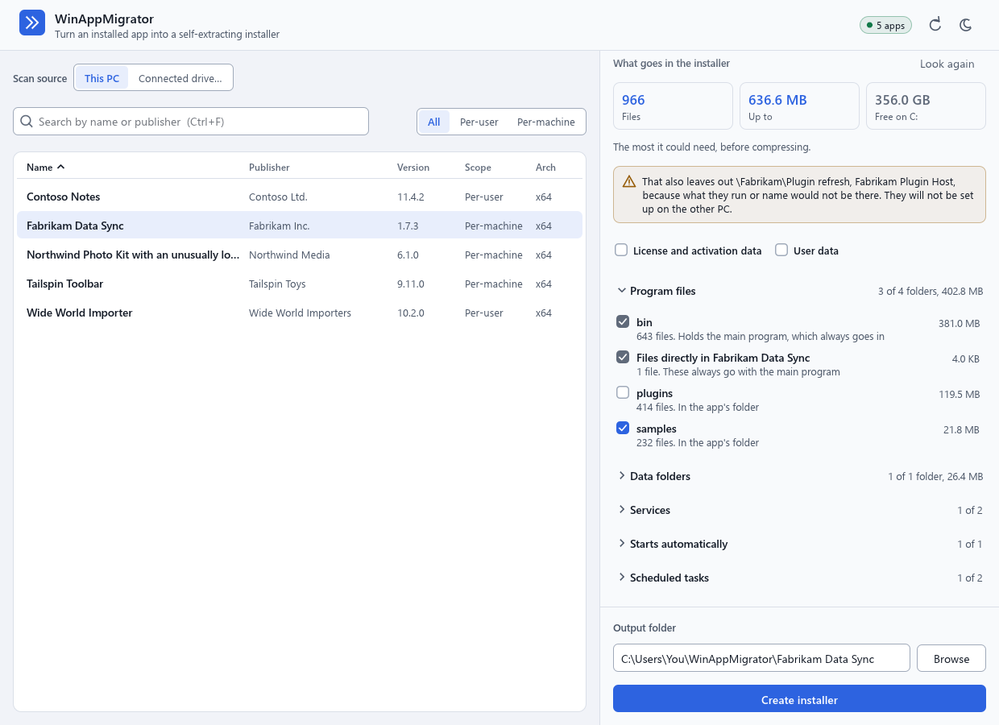

<p align="center">
  
</p>

<h1 align="center">WinAppMigrator</h1>

<p align="center">
  <strong>Turn an installed Windows app into one installer you can run on another PC.</strong><br>
  Even when the app came from a drive pulled out of a dying machine, and the original installer is long gone.
</p>

<p align="center">
  <a href="https://github.com/RandyNorthrup/WinAppMigrator/releases/latest"></a>
  <a href="https://github.com/RandyNorthrup/WinAppMigrator/releases"></a>
  <a href="https://github.com/RandyNorthrup/WinAppMigrator/stargazers"></a>
  <a href="https://github.com/RandyNorthrup/WinAppMigrator/actions/workflows/ci.yml"></a>
  
  
  <a href="LICENSE"></a>
</p>

<p align="center">
  <a href="https://github.com/RandyNorthrup/WinAppMigrator/releases/latest"><strong>Download</strong></a> ·
  <a href="#how-it-works">How it works</a> ·
  <a href="#what-gets-captured">What gets captured</a> ·
  <a href="#limitations">Limitations</a> ·
  <a href="#documentation">Docs</a>
</p>

<p align="center">
  <picture>
    <source media="(prefers-color-scheme: dark)" srcset="docs/images/app-pick-dark.png">
    
  </picture>
</p>

## Why

Reinstalling software on a new PC usually means hunting down installers, license files, and
settings. Sometimes the installer no longer exists, the vendor is gone, or the old PC will not boot.
WinAppMigrator works backward from what is installed: it finds the app's files, registry entries,
services, and runtimes, and packs them into a single `.exe`, or two files if it is too big for one.

- **One file, as long as Windows allows.** The app is one portable `.exe`, and so is an installer, unless its
  package would pass the 4 GiB Windows can start. Then it is a small `.exe` and a data file, which stay together.
- **Works from a pulled drive.** Connect the disk from a failed PC and pick an app from it.
- **Brings the runtimes along.** The Visual C++ and modern .NET runtimes an app needs are downloaded when you build
  and embedded, so they install without internet, unless one could not be downloaded then.
- **Checks its work.** The installer checks its package's hashes before writing anything, then reads back
  the files it installed and checks those.
- **Shows you first.** Pick an app and it says what would go in the installer and how big that can be, before you
  click anything. Leave out what you do not want, and add what looks related that exact names missed.
- **Says whether it fits.** A build and an install each work out how much room they need before they start, and
  an app that cannot run on the other PC is refused before anything changes.
- **Says what it will do.** Before installing, it lists the services, drivers, scheduled tasks, autostart
  entries, shortcuts, `Path` changes, shell extensions, link protocols, file types, COM classes, firewall rules,
  and the rest of what it sets up, what it left out, and whether it is signed and by whom. What depends on what is on
  that PC can only be seen as it installs, and is then left alone and said. A preview goes
  further, listing the changes themselves, the first 300 in its window.
- **Can be undone.** If anything goes wrong, or you cancel, what it did is put back, but for a runtime it installed, and it
  says if anything could not be. Later, you can uninstall it from Settings like any other app, and a file it replaced comes back, or goes beside what has
  changed since.

## How it works

Download `WinAppMigrator-v<version>.exe` from the
[latest release](https://github.com/RandyNorthrup/WinAppMigrator/releases/latest) and run it. There
is nothing to install. Windows asks for administrator approval, because reading another drive and
installing services both need it. The same app comes in a zip with this file and its license, and
`SHA256SUMS.txt` has the checksum of both. It is an x64 program, and Windows on Arm runs it through emulation.

### 1. Pick an app

Choose **This PC**, **Connected drive…** (a disk from another PC, plugged in), or **Disk image…** (a `.vhd` or `.vhdx`
of another PC, which the app attaches read-only itself), then search or sort the list. A drive or an image can have Windows
7, 8 or 10 as well as 11: see [Limitations](#limitations). Selecting an app looks at it in the
background, and picking another stops that. Optionally include the app's license data and user data. An installer
holds one account's data, so if more than one account has data for the app, you choose whose.

With **User data** off, what the app remembers for you in the registry stays behind as well as its data folders:
preferences along with recent files and saved sessions. So it should start on the other PC much as it would for someone new,
except for what it keeps among its own program files and machine-wide settings, which go as they are.

### 2. See what goes in

The screen says how big the installer can be and whether it fits, then lists what it holds: program files, data
folders, services, startup items, scheduled tasks, shortcuts, what ties the app into Windows, and the runtimes it
needs. Untick a folder, a service, or anything else you do not want, and the size follows. If that leaves something with
nothing to run, it goes too, and the screen says so, so no service, task, or shortcut is set up pointing at what you left out.
Only what holds
the main program, or what it cannot start without, has to stay.

**Might also be part of it** lists what exact names left out and looks related, each with why, such as a folder with a
close name or a part of the app that no list of apps shows. None of it goes in unless you tick it, and it then goes through
the same checks as the rest. What looks like a credential cannot be ticked, whatever it is in. What is left out, and why,
is at the end, by name.

<p align="center">
  <picture>
    <source media="(prefers-color-scheme: dark)" srcset="docs/images/app-choose-dark.png">
    
  </picture>
</p>

### 3. Build the installer

Follow the progress, or cancel. The build goes by what is on the screen and reads each file then, so a file that changed
is right, and one that has gone is listed. You get one file, named after what it contains, such as
`Fabrikam_Data_Sync_userdata_license_installer.exe`, by default in a folder named for the app, under `WinAppMigrator` in your
profile folder. A package too
big for one executable comes as two files, `.exe` and `.wamdata`, and the window says they have to stay together.

With User data off, the build then looks through what the installer says about the app, though not the app's own files or
license files, for your account, profile folder, PC name, and SID. The
finished screen says where it found any, so you can decide what to do about that, and the installer is built either way.

<p align="center">
  <picture>
    <source media="(prefers-color-scheme: dark)" srcset="docs/images/app-done-dark.png">
    
  </picture>
</p>

### 4. Run it on the other PC

Copy the installer over, with its data file if it has one, and run it. Check the install location, preview the
changes if you like, then click **Install**. If the installer holds user data or license data, each has a box, ticked to start
with, so untick what you do not want here. A folder with files in it is refused unless an install is on record there,
so use an empty one. Follow the progress, or cancel, which puts back whatever it has done so far. It stops first if the
app cannot run on that PC or there is not enough room, and says if the app might not work there, such as on a Windows
older than the one it came from. When it has checked what it installed, it starts the services that start by themselves.

<p align="center">
  <picture>
    <source media="(prefers-color-scheme: dark)" srcset="docs/images/installer-dark.png">
    
  </picture>
</p>

<sub>Screenshots use sample data, and follow your GitHub theme. The app has light and dark modes, and starts
in the one Windows is in until you choose. An installer goes by the same, where it runs.</sub>

## What gets captured

| What | Included | Notes |
| --- | --- | --- |
| **Program files** | Yes, unless you untick a folder | Found through MSI and Inno Setup records, NSIS logs, App Paths, and folders named exactly for the product. What holds the main program always goes in. Empty folders come along too, up to 10,000 |
| **Registry** | Yes, unless you untick a kind of it | The app's machine-wide keys, plus what points at a file it has: COM classes with their type libraries, interfaces, and AppIDs, file types, link protocols, menu commands, shell extensions, Default apps entries, and 32-bit Run and App Paths entries. Without User data, an account's keys go only where Windows itself looks for an app, plus a value saying where the app is. Values outside the app's own keys and those kinds are a row of their own in what the installer lists |
| **Firewall rules, fonts, ODBC, event log sources, compatibility settings** | Yes, unless you untick a kind of it | Each only for a file the app has. A font in `C:\Windows\Fonts` comes only if a machine-wide install record names it, and goes in the install folder |
| **Certificates** | Reported only | The ones the app seems to rely on are named. They are never installed, because whether to trust one is for you to decide |
| **Services and drivers** | Yes, unless you untick one | Services keep their arguments, settings, and built-in account, and one set to start by itself is started once the install has checked what it installed. One that will not start is a warning, and the app stays installed. A custom account's password cannot be moved, so that service is set up as LocalService and the installer says so. Drivers the app owns are re-registered, though no test has loaded one. Vendor and inbox drivers are reported instead, because they cannot be redistributed |
| **Scheduled tasks** | Yes, unless you untick one | A task that ran as a person runs as whoever installs it. With User data off, one told to work on something in someone's folders stays behind |
| **Shortcuts** | Yes, unless you untick one | One in your own folders goes without User data only if it just opens the app, and then to the Desktop or Start Menu of whoever installs it. An app installed for one account keeps its own |
| **Environment variables** | Yes, unless you untick that kind | Those that hold the app's path. A captured `Path` holds only the app's entries, and is merged into the target's, never replaced |
| **Runtimes** | Always, even if what needed one was left out | Read from the main program and up to 64 others, nearest the top of its folder first. Visual C++ 2005 and later, and .NET 6 to 10, are embedded, or come through winget if the download failed at build time. .NET Framework 3.5 is a Windows feature that can need internet on the target, and 4.x is part of Windows. A runtime with no installer here, such as Visual C++ 2003, .NET 5, or one with no Arm64 build for an Arm64 app, is named in a warning, and nothing is installed in its place |
| **User data** | Your choice | What an account keeps for the app in the registry, such as settings, recent files, and saved sessions, and AppData, ProgramData, Public Documents, Documents, and Saved Games. Online-only OneDrive files are listed, not copied |
| **License data** | Your choice | License files and stores, and license values in the account's part of the registry. A license value in machine-wide settings or under the publisher's own key, and a store tied to the hardware, such as CodeMeter or Sentinel, are only named, never copied. With this off none of it is captured, and only their names are noted. Reports whether each is likely tied to the machine. [Never bypasses activation](https://github.com/RandyNorthrup/WinAppMigrator/blob/main/SECURITY.md#licensing-data) |
| **Near matches** | Only if you tick them | Folders with a close name, and parts of the app no list shows, up to 200 of them. [What is never offered](https://github.com/RandyNorthrup/WinAppMigrator/blob/main/docs/discovery.md#near-matches) |
| **Credentials** | Never | Values and files that look like passwords, tokens, or private keys are left out and named before you build, and cannot be ticked. [This cannot catch everything](#security-and-signing) |

## What it has been tried on

Every push to `main` moves five real open-source apps from one CI runner to fresh ones: 7-Zip, PuTTY, Eclipse Mosquitto,
windows_exporter, and Git LFS, installed by their publishers' own setups, which are custom, MSI, NSIS, and Inno Setup. They go to
Windows Server 2022, Windows Server 2025, and Windows 11 on Arm, where each was and in a folder of another name, and
Windows is asked to use what was restored: an archive made and unpacked, a COM class activated, a file type
opened, a shortcut started, and a service started by the install answering a real client. After an uninstall, the values,
services, tasks, firewall rules, and folders it compares are as they were. Each check is shown to fail without the app.

Those are small, well-behaved apps on clean machines, and this is how far that goes:

- **Which Windows.** Those three, on x64 runners and through emulation on Arm. Windows 10 and 11 are what this is for, and
  neither desktop Windows 10 nor desktop Windows 11 on x64 has been run on CI.
- **A pulled drive.** That path runs on a VHD built on the runner and made to look like another PC's. A real disk from
  another PC has not been run on CI.
- **Windows 7.** Off CI, by hand: Windows 7 SP1 VMs, 32-bit and 64-bit, with 7-Zip 9.20, Notepad++, VLC 2.2.8 and two
  small apps of the XP era, one keeping its settings beside itself and one using DirectX 9. Each disk was exported as a
  `.vhdx`, read with **Disk image…**'s own code, and built into installers that checked out. LegacyNotes, RetroBlocks and
  Notepad++ were installed on Windows 11 25H2, run as a person would, and uninstalled, and each started with what it had on
  Windows 7. 7-Zip and VLC were built but not installed, as that PC has newer ones.
- **Runtimes.** Of those it can install, only the x64 Visual C++ 2015 and later has been installed for real, on a runner
  it was taken off. The others are downloaded and checked as Microsoft's, and the winget and Windows feature routes have not been run.
- **Real windows.** They are opened on runners whose logs show a software renderer and a 1024x768 screen, and clicking
  through them is only done with no real window. A real graphics card, display scaling, and more than one monitor have not been run.
- **Uninstalling.** CI runs the quiet command an entry in Settings records, `QuietUninstallString`, and only opens the
  windowed one. It has not clicked **Uninstall** in Settings or in the uninstaller's window.
- **Signing.** `v0.5.0` is the first release that is signed. A certificate of your own on an installer has only been tried with a throwaway one.
- **What has not been tried at all.** An app with online activation, a driver being loaded, an app the size of an office
  suite, an app's own updater after a move, and a restart afterward.

So try an installer before you rely on it.

## Limitations

Please read these before relying on it, especially on a one-way trip from a failing PC. The first few matter most, and
the rest are grouped below: click a group to open it.

- **The app's own setup does not know it moved.** Its entry in Settings runs this project's uninstaller. Windows Installer
  has no record of an MSI app on the new PC, so the app's own updater or repair can treat it as not installed, and an
  Inno Setup app's own uninstaller, if something else runs it, would only say its log is missing.
- **It can miss what is kept under another name.** Beyond what the install records name, folders and
  registry keys are matched by the product's exact name. What is close to that is offered for you to tick, and what is
  under a name nothing like it stays behind. Check what the screen lists. If it looks wrong, don't rely on that installer.
- **Some licenses will not move.** Anything tied to the old machine may need reactivating.
- **Its windows need Direct3D 12,** which an old graphics driver or a virtual machine may not have. Without it the
  program says so. An installer can still run with `--apply`, and an uninstaller with `--quiet`, from an administrator's
  command prompt. The app has no such route.
- **Reading a failing drive can finish it off,** so **image a failing drive first**, and scan the image.
- **It is only for software you are licensed to move.** That part is up to you.

<details>
<summary><strong>What a build can leave behind</strong></summary>

- **An app made of several packages only gets its own, unless you add the rest.** NVIDIA App's `NVIDIA Container` is a
  separate hidden entry, for example, which is offered, and it goes in if you tick it. Another entry in the list of apps
  is another app, and is not offered.
- **What you leave out is up to you.** The screen knows what runs a file, and what is told to use one by a path. It
  cannot know what a program does by itself, so a program can still need a folder you unticked.
- **Runtimes stay as they were found.** A runtime only a folder you left out needed still goes in, since telling that
  takes knowing what else needs it. It only costs room.
- **What is on the screen is as of when the app was looked at.** A build reads each file then, so a file that changed is
  right, and one that has gone is listed. Something new since then is not in it until you click **Look again**.
- **A link in an app's folder is not followed,** and neither is a folder more than 64 levels down. Each is named in a warning.
- **The registry is captured up to a limit,** 1 MiB for a value, 512 keys and 8 levels for what is under one key, and
  100,000 values for an app. Reaching one is a warning, and the rest stays behind.
- **Some things stay behind.** An ODBC source that uses Windows' own driver has to have the app's exact name,
  since it points at a driver and not at the app. A firewall rule with a `TTK` condition is not carried, since it could let in
  more on the other PC. A driver file with no service that loads it is named, and stays. Microsoft Store apps are not listed.

</details>

<details>
<summary><strong>Building</strong></summary>

- **An installer past 4 GiB is two files.** Windows cannot start an executable that large, so a package too big for
  one, which is 1 MiB short of that to leave room for a signature, is a small `.exe` and a `.wamdata` file beside it with the
  same name. They have to stay together, in one
  folder, with those names. A data file that is missing, or is not the one it was built with, is refused and
  nothing is read from it.
- **The room a build asks for is the most it could take.** It assumes nothing compresses, because that cannot be
  known ahead of time, so it can stop on a drive the installer would have fit on. Choose an output folder on another
  drive. A package of over 4 GiB before compressing is allowed at least 8 GiB, in case it comes out small enough for one
  executable and has to be copied after the stub. A runtime it downloads is counted as 150 MiB.
- **Building to a FAT32 or exFAT drive needs room on your system drive.** Those drives cannot keep the
  build's working files private, so they go in the system's temp folder, and only the installer is
  written to the drive. FAT32 also cannot hold a file of 4 GiB, so a build that large stops there when it gets
  that far.

</details>

<details>
<summary><strong>Installing</strong></summary>

- **Whether an app can run on the other PC goes by what its programs say.** A package records the architecture of up to
  2,000 of its programs, its main program, services, and drivers first, and the oldest Windows their headers name. That is what
  Windows itself holds them to, and it does not say what else a program relies on, so an app built on a newer Windows may need
  what an older one does not have.
- **An install location has to be on a drive of this PC, and not under a link.** A network share is refused,
  and so is a folder that is a link or under one. Use the place it leads to instead. If a data folder such as
  `%AppData%` is under a link, and the app has data to restore there, it is refused before anything of this
  install changes, so install it without its user data and license data. A volume mounted on a folder is
  allowed if Windows gives that folder as where it is, though that has not been run on a real one. If it is refused, use its
  drive letter.
- **Where it unpacks has to be private.** That is an admin-only folder, or a place that gives no one else a way to keep hold of
  what is made there, on the install location's drive first, and beside the installer or in the temp folder last, so each of
  those can need the room. If there is nowhere like that, the install does not go ahead.
- **What another app has on the new PC stays that app's.** A link protocol, a file type, a COM class, an event
  log source, a font name, or anything like it that is already there as something else's is left alone,
  `--force` or not, and the installer says so. An app that expected to be the one opening `http` links has to be
  set as the default again, as Windows would have you do anyway.
- **An installer leaves out what no app should do.** That includes autostart entries that run something
  it does not install, such as a Run value that goes through `rundll32`. What it leaves out is listed in its
  window, and the rest of the install goes ahead. If what it sets up relies on a file it left alone, it installs nothing,
  rather than have that run whatever is already there.
- **Shortcuts go to this PC's Desktop and Start Menu:** yours, or everyone's if that is where they were. One from a
  Desktop folder with an unusual name is left out and reported.
- **Hash checks have limits.** They catch damage, and tampering by anyone who does not also update the
  hashes. A preview checks only the installer's overall hash, not each file, and its window lists the first
  300 changes, with services, tasks, and shortcuts first, so on a larger app not every file is listed.
- **A file replaced on another drive is copied aside.** Only a file on the same drive as `ProgramData` can be moved. One elsewhere
  takes more time, and its permissions are kept beside it and put back with it. If they cannot be, the file stays where it is, and the
  install or the undoing of it says so.
- **A file named like a device, such as `aux.h`, cannot be installed before Windows 11.** Earlier versions
  open that name as the device instead. An installer holding one stops and says so, before anything is
  installed. That has been run on Windows Server 2022, build 20348, where writing to `aux.h` goes to `\\.\aux`, and
  on builds 26100 and 26200, where it is a file and installs. Windows 10 itself has not been run, and build 22000 is
  where this assumes the change falls. Windows PowerShell's `Get-FileHash` says such a file does not exist
  even where it is one, so use PowerShell 7 to check it.

</details>

<details>
<summary><strong>Uninstalling</strong></summary>

- **What an uninstall leaves.** Files and settings that changed after the install stay, and it says which. A
  file one of those replaced goes beside it, as `name.before-install`, and is never lost.
  So do files you added, with the folders they are in, and user data and licenses unless you ask for them
  to go. A runtime it installed stays, because other programs may be using it, including when a failed
  install is rolled back. A service that ran as a custom account does not get its password back, because it
  was never in the installer. Uninstalling an install made over another brings the earlier one back,
  which has its own entry in Settings. A service that will not stop goes when the PC restarts. A file that
  a kept service, task, or value still uses stays with it. If part of it is on a drive that is not
  connected, the entry stays, so connect the drive and run it again.
- **An uninstaller shows "Unknown publisher" at its UAC prompt,** even for an installer you signed, because
  [the stub must never be signed](https://github.com/RandyNorthrup/WinAppMigrator/blob/main/docs/signing.md).

</details>

<details>
<summary><strong>Connected drives</strong></summary>

- **A connected drive only gives what is on it.** Nothing it says is followed off it, and no link on it is
  followed at all, because a link on another PC's disk leads to this PC's files. So an app or data kept on
  another of that PC's disks, or reached through a link, stays behind, and the build says so. A connected
  drive can be read by a build but not checked to be what it says, so build only from one you have reason to
  trust, and read what it lists.
- **The app does not write to a connected drive,** which reads a copy of its registry files. Windows itself
  can still update last-access times and its own records on any disk it mounts.
- **A disk image is attached read-only** and with no drive letter, and detached when you pick another source or close
  the app. Only `.vhd` and `.vhdx`, which Windows can attach: an image from VMware or VirtualBox has to be saved as one
  first, and one Windows already has attached is refused, since something else may be writing to it.
- **From Windows 7 (or Vista, 8 or 8.1),** what Windows kept aside for an older app comes along with User data and goes
  in the app's own folder and keys, an app from 32-bit Windows goes to `Program Files (x86)`, and the DirectX 9 runtime is
  installed with an app that needs it, which takes the internet where it is installed. A DLL that came from Windows 7's
  own folders and that Windows 11 lacks is named and not brought. A 16-bit program, a driver signed only for Windows 7,
  and anything that used the Sidebar, Media Center or Internet Explorer itself will not work on Windows 11.

</details>

<details>
<summary><strong>Accounts and their data</strong></summary>

- **An installer holds one account's data.** It is read from whoever is signed in, or from the account you
  choose, and goes to whoever is signed in where the installer runs. That is so even if another
  administrator was named at the UAC prompt, and if who is signed in cannot be told, it says so and leaves
  per-user data and settings out rather than guessing.
- **Documents or Saved Games outside your profile are not written to,** since an elevated installer writes
  wherever those settings point, and anyone can change them. Moved somewhere inside it, as OneDrive does,
  they work as usual. Otherwise those files go under the install folder, in `_external`, and the installer
  says so before it starts.

</details>

Open issues are tracked in the [plan](https://github.com/RandyNorthrup/WinAppMigrator/blob/main/docs/PLAN.md#open-issues-most-important-first).

## Security and signing

- **Only run installers you trust.** An installer runs elevated and installs what its package holds. It
  refuses what no app should do and lists what it will set up, but only a signature proves who made it.
- **An installer can contain secrets.** Values and files that look like credentials are left out and named
  when you build, and with the License option off so are license files and values. That goes by names and a
  few shapes of text. It cannot see inside an app's own settings file or database, or catch a value with a name
  that does not say what it is. So treat an installer as being as sensitive as the PC it came from.
  [More](https://github.com/RandyNorthrup/WinAppMigrator/blob/main/SECURITY.md#an-installer-can-contain-secrets).
- **Installers from before `0.5.0` can say more.** Those can hold the name of the PC and account they were built on, and what
  apps remember in the registry, such as recent files and hosts, even with User data off. Treat them as private.
- **Signing.** From `v0.5.0` on, the app is signed (publisher: Randy Northrup), and each release
  records build provenance you can check with `gh attestation verify`. Earlier downloads are
  unsigned. Installers you build are not signed unless you sign them, so Windows shows "Unknown
  publisher" for them. [Why, and how to sign one](https://github.com/RandyNorthrup/WinAppMigrator/blob/main/docs/signing.md).

More in [SECURITY.md](https://github.com/RandyNorthrup/WinAppMigrator/blob/main/SECURITY.md).

## Automating the installer

Run with any argument, an installer skips its window. It previews unless you pass `--apply`, and exits
non-zero if anything fails, after putting back what it did. With no arguments that say what to do, it
prints usage. Automation needs an elevated shell, because an installer demands elevation.

An installer is a windowed program, so PowerShell only waits for it, shows what it says, and sets `$LASTEXITCODE` if
you pipe it somewhere:

```powershell
# Preview
.\App_installer.exe --target-root "C:\Program Files\App" | Out-String

# Install, and see how that went
.\App_installer.exe --target-root "C:\Program Files\App" --apply | Out-String
$LASTEXITCODE

# Uninstall, with the id it printed, or the QuietUninstallString in its entry in Settings
& "C:\ProgramData\WinAppMigrator\installs\wam-abc123\uninstall.exe" --uninstall wam-abc123 --quiet | Out-String
```

An installer takes:

- `--target-root <DIR>`: where to install, as a full path. Without it, `--apply` and `--dry-run` use where the app was, if
  the checks the window makes allow that.
- `--apply`: actually install. Without it nothing is installed: the package is unpacked to a temporary folder, which
  is then removed.
- `--dry-run`: preview, stated explicitly.
- `--force`: replace what is already there, as below.
- `--restore-user-data`: put user data in the real AppData, Documents, Saved Games, and ProgramData folders of whoever
  is signed in, not under the target.
- `--no-restore-license`: skip captured license data, which is otherwise restored.
- `--log <FILE>`: also write the log to this file, which must not exist yet.
- `--help` and `--version`.

An uninstaller reads only the record in the fixed location, and takes:

- `--uninstall <ID>`: which install to undo.
- `--quiet`: no window.
- `--remove-user-data`: also remove user data and licenses.
- `--log <FILE>`: with `--quiet`, also write the log to this file, which must not exist yet.

Both print what they did, their warnings and errors, and what they left out, and an installer says how much room it
needs on each drive before it starts.

Logs are in `%ProgramData%\WinAppMigrator\logs`, which only administrators can read, with the last 20 kept.
They hold paths and key names, and never what a registry value, license file, or environment variable holds.

### What `--force` does

`--force` replaces existing files, registry values, services, tasks, shortcuts, and environment variables. Without it, a folder
with files in it and no install on record stops the install before anything changes, whether or not any would be replaced, and
so does an existing file. The window will not use such a folder at all.

Only use it for a folder you know is this app's. A file of the same name is replaced, and comes back on uninstall, and another
app's service could be running that file. Services, tasks, and what ties an app into Windows stay another app's either way.
Outside the install location, no program goes in a folder that was already there without an install on record. A data file
there is replaced.

## What it keeps on your PC

- **The app** needs no install, and keeps only the light or dark mode you choose, in `%LOCALAPPDATA%\WinAppMigrator\theme.txt`.
  What it builds goes in the output folder you give it, by default under `%USERPROFILE%\WinAppMigrator`.
- **`%ProgramData%\WinAppMigrator`**, which only administrators can get into, holds logs, what an install needs to undo itself,
  and while one runs, what it has unpacked. A scan of a connected drive, or of an account that is not signed in, also keeps copies
  of registry files there while it runs.

## Building from source

You need Windows, [Rust](https://rustup.rs) through rustup, which picks the pinned 1.99.1 by itself, and the Visual
Studio C++ build tools. The app carries the installer inside itself, so build the installer first:

```powershell
cargo build --release -p winappmigrator-installer
$env:WINAPPMIGRATOR_INSTALLER_STUB = "$PWD\target\release\winappmigrator-installer.exe"
cargo build --release -p winappmigrator-gui
.\target\release\winappmigrator.exe
```

A release build of the app with no installer to carry stops there.

| Crate | What it is |
| --- | --- |
| [`winappmigrator-core`](https://github.com/RandyNorthrup/WinAppMigrator/tree/main/crates/winappmigrator-core) | Discovery, packaging, restore, and verification |
| [`winappmigrator-ui`](https://github.com/RandyNorthrup/WinAppMigrator/tree/main/crates/winappmigrator-ui) | Shared design system, widgets, and process hardening |
| [`winappmigrator-gui`](https://github.com/RandyNorthrup/WinAppMigrator/tree/main/crates/winappmigrator-gui) | The app, built as `winappmigrator.exe`. Never restores anything |
| [`winappmigrator-installer`](https://github.com/RandyNorthrup/WinAppMigrator/tree/main/crates/winappmigrator-installer) | The stub inside every installer, and the only caller of the restore code |

Run the checks with the commands in [CONTRIBUTING.md](https://github.com/RandyNorthrup/WinAppMigrator/blob/main/CONTRIBUTING.md). Releases are built by
[GitHub Actions](https://github.com/RandyNorthrup/WinAppMigrator/blob/main/.github/workflows/release.yml) when a `v*` tag is pushed.

## Documentation

| Document | What it covers |
| --- | --- |
| [Discovery](https://github.com/RandyNorthrup/WinAppMigrator/blob/main/docs/discovery.md) | How an app's footprint is found, and from a connected drive |
| [Interface](https://github.com/RandyNorthrup/WinAppMigrator/blob/main/docs/gui.md) | How the screens are built, and the design conventions |
| [Signing](https://github.com/RandyNorthrup/WinAppMigrator/blob/main/docs/signing.md) | What is signed, what must never be, and how |
| [Plan](https://github.com/RandyNorthrup/WinAppMigrator/blob/main/docs/PLAN.md) | Scope, and open issues in priority order |
| [Security](https://github.com/RandyNorthrup/WinAppMigrator/blob/main/SECURITY.md) | The trust model, and how to report a vulnerability |
| [Contributing](https://github.com/RandyNorthrup/WinAppMigrator/blob/main/CONTRIBUTING.md) | The project's rules and checks |
| [Changelog](CHANGELOG.md) | What changed in each release |

## License and support

[MIT](LICENSE) © 2026 Randy Northrup. Third-party attributions are in
[THIRD-PARTY-LICENSES.md](THIRD-PARTY-LICENSES.md).

If this saves you time, you can [buy me a coffee](https://www.paypal.com/donate/?hosted_button_id=Q9VC7B42R7K82)
or [sponsor on GitHub](https://github.com/sponsors/RandyNorthrup). Thank you!
