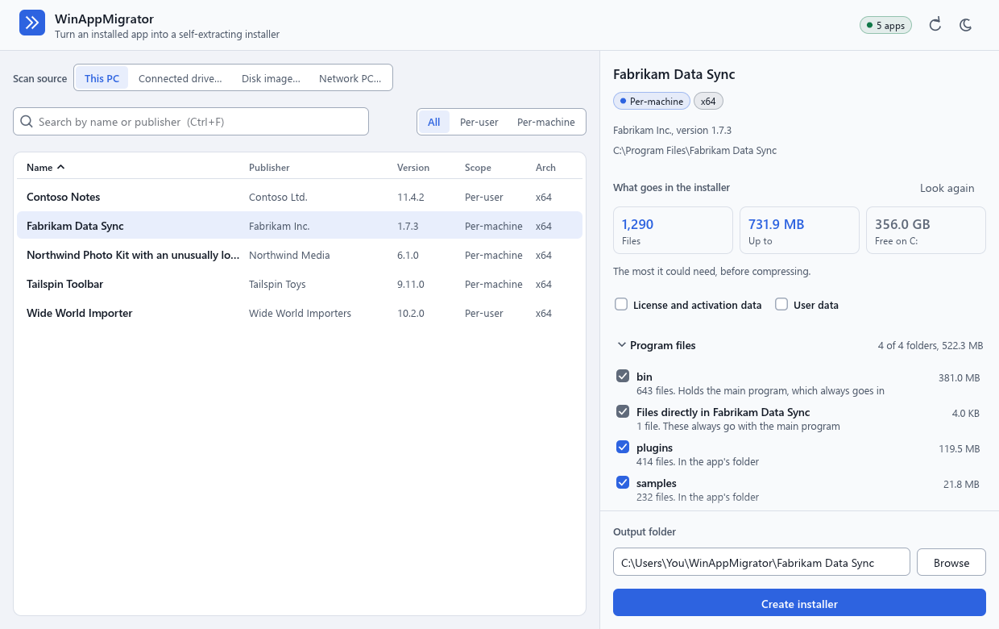

<a id="getting-started"></a>

# Primeros pasos

Esta página te lleva desde la descarga hasta la primera pantalla de la aplicación.

<a id="what-you-need"></a>

## Qué necesitas

- **Windows 10 o Windows 11, de 64 bits.** La aplicación es un programa x64. Windows 11 en Arm la ejecuta mediante [emulación](Glossary#emulation). Windows 10 en Arm no puede ejecutar programas x64, y Windows de 32 bits no puede ejecutarla de ninguna manera. Windows 10 y 11 de escritorio en x64 no se han ejecutado en las pruebas del proyecto, que usan Windows Server 2022 y 2025 y Windows 11 en Arm. Consulta [Requisitos y pruebas](Requirements-and-Testing).
- **Permisos de administrador** en el PC. La aplicación siempre los pide al iniciarse. Consulta [Permisos de administrador](Glossary#administrator-rights).
- **Direct3D 12**, que Windows usa para dibujar la ventana de la aplicación. Windows 10 y 11 normalmente lo tienen. Puede que un controlador de gráficos antiguo o una máquina virtual no lo tengan. Consulta [Direct3D 12](Glossary#direct3d-12).
- **Espacio en una unidad** para el instalador que crees. La aplicación te indica cuánto antes de empezar.
- **La conexión a internet en el PC antiguo es opcional.** Si hay conexión cuando creas el instalador, la aplicación descarga los [entornos de ejecución](Glossary#runtime) de Microsoft que puede incluir y los coloca dentro del instalador. Consulta [Entornos de ejecución](Runtimes).

Encontrarás más detalles, y qué se ha probado y qué no, en [Requisitos y pruebas](Requirements-and-Testing).

<a id="download"></a>

## Descarga

Ve a la [última versión](https://github.com/RandyNorthrup/WinAppMigrator/releases/latest). Tiene tres archivos:

| Archivo | Qué es | Descárgalo si |
| --- | --- | --- |
| `WinAppMigrator-v0.7.3.exe` | La aplicación en sí. Un solo archivo, sin nada que instalar. | Solo quieres usarla. Es el que quiere la mayoría de la gente. |
| `WinAppMigrator-v0.7.3-windows-x64.zip` | La misma aplicación, como `winappmigrator.exe`, con el README, el registro de cambios, la licencia y las licencias de terceros | También quieres la documentación |
| `SHA256SUMS.txt` | Las sumas de comprobación de los dos archivos anteriores | Quieres comprobar la descarga |

La parte que va dentro de cada instalador, el [programa base del instalador](Glossary#installer-stub), nunca se publica por separado. Ya está dentro de la aplicación.

<a id="check-the-download"></a>

## Comprobar la descarga

Es opcional, pero merece la pena. Cada una de las comprobaciones siguientes es independiente. Ejecútalas en PowerShell, en la carpeta donde guardaste el archivo.

**1. La suma de comprobación.** Un [hash](Glossary#hash) es una huella digital de un archivo. Si cambia aunque sea un solo byte, el hash cambia.

```powershell
Get-FileHash .\WinAppMigrator-v0.7.3.exe -Algorithm SHA256
Get-Content .\SHA256SUMS.txt
```

El número largo que muestra `Get-FileHash` debe coincidir con el de la línea de ese archivo. `Get-FileHash` muestra letras mayúsculas y el archivo usa minúsculas. No pasa nada: compara las letras y los dígitos.

**2. La firma.** Una [firma](Glossary#signature) indica quién creó el archivo y que no ha cambiado desde entonces.

```powershell
$signature = Get-AuthenticodeSignature .\WinAppMigrator-v0.7.3.exe
$signature.Status                     # should say Valid
$signature.SignerCertificate.Subject  # should include CN=Randy Northrup
```

También puedes hacer clic con el botón derecho en el archivo, elegir **Propiedades** y mirar la pestaña **Firmas digitales**. La versión 0.5.0 es la primera cuya aplicación está firmada. Las descargas de versiones anteriores no están firmadas.

**3. Dónde se creó.** Cada versión a partir de la 0.5.0 deja constancia de que la creó el propio flujo de trabajo de publicación de GitHub, a partir de este repositorio. Esa constancia se llama [atestación](Glossary#attestation). Si tienes la [CLI de GitHub](https://cli.github.com/), ejecuta:

```powershell
gh attestation verify .\WinAppMigrator-v0.7.3.exe --repo RandyNorthrup/WinAppMigrator
```

Lo mismo sirve para el zip.

<a id="start-it"></a>

## Iniciarla

1. **Haz doble clic** en `WinAppMigrator-v0.7.3.exe`. No hay nada que instalar. Se ejecuta desde donde la hayas guardado.
2. **SmartScreen.** [SmartScreen](Glossary#smartscreen) de Windows puede mostrar una pantalla "Windows protegió tu PC" para un archivo que no ha visto a menudo. Si lo hace, elige **Más información** y comprueba que el editor es Randy Northrup antes de elegir **Ejecutar de todas formas**.
3. **La solicitud de administrador.** Windows pregunta si quieres permitir que la aplicación haga cambios. Es la [solicitud de UAC](Glossary#uac-prompt). La aplicación siempre la muestra, porque para leer la unidad de otro PC, y los archivos que solo pueden leer los administradores, se necesitan permisos de administrador. En la descarga firmada, la solicitud indica **Randy Northrup** como editor comprobado. Si para este archivo indica "Editor desconocido", no es el archivo firmado de la versión publicada, así que no lo ejecutes.
4. **Se abre la ventana.** Si en su lugar ves un mensaje que dice que no se ha podido abrir la ventana y que se necesita Direct3D 12, consulta [Solución de problemas](Troubleshooting#the-window-could-not-open). La aplicación no puede ejecutarse sin su ventana.

<a id="first-run"></a>

## Primera ejecución

<p align="center">
  <picture>
    <source media="(prefers-color-scheme: dark)" srcset="https://raw.githubusercontent.com/RandyNorthrup/WinAppMigrator/main/docs/images/app-pick-dark.png">
    
  </picture>
</p>

- La lista de aplicaciones instaladas está a la izquierda. Mientras se carga, la pequeña etiqueta de la parte superior derecha indica **Cargando** y, después, cuántas aplicaciones ha encontrado, por ejemplo **5 aplicaciones**.
- La ventana se abre en modo claro u oscuro, según el que use Windows. El botón del sol o de la luna de la parte superior derecha cambia el modo, y la aplicación recuerda lo que elijas. Consulta [Archivos que guarda en un PC](Files-It-Keeps-on-a-PC). Con un tema de contraste de Windows, usa los colores del tema y no muestra ese botón.
- Habla tu idioma de presentación de Windows si es uno de sus 24 idiomas, y si no, inglés. **Idioma**, en la parte superior derecha, los muestra con su propio nombre y cambia la ventana al instante; la aplicación recuerda lo que elijas. El árabe, el persa, el urdu y el hebreo se muestran de derecha a izquierda. Consulta [Idiomas y accesibilidad](Languages-and-Accessibility).
- Haz clic en una aplicación. El lado derecho muestra qué se incluiría en su instalador, y empieza a calcularlo al instante. No se crea nada hasta que haces clic en **Crear instalador**.

Siguiente: [Crear un instalador](Building-an-Installer).
