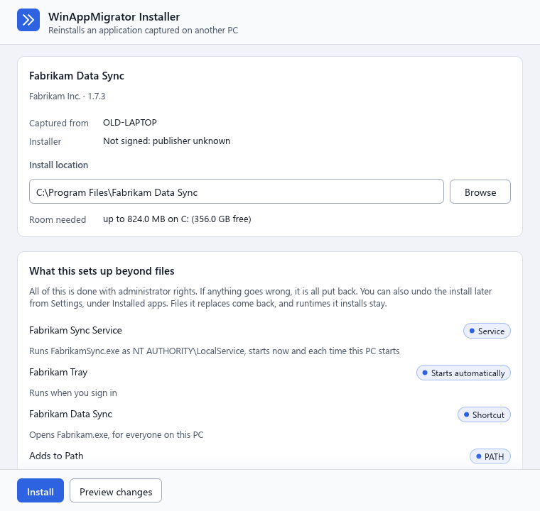

# نئے PC پر انسٹال کرنا

انسٹالر ایک ونڈو ہے۔ یہ خود کو جانچتا ہے، آپ کو دکھاتا ہے کہ یہ کہاں انسٹال کرے گا اور کیا کچھ سیٹ اپ کرے گا، اور صرف اس وقت انسٹال کرتا ہے جب آپ **انسٹال کریں** پر کلک کریں۔ یہ صفحہ اسکرین پر لکھے الفاظ استعمال کرتے ہوئے اسے اوپر سے نیچے تک بیان کرتا ہے۔

  <picture>
    <source media="(prefers-color-scheme: dark)" srcset="https://raw.githubusercontent.com/RandyNorthrup/WinAppMigrator/main/docs/images/installer-dark.png">
    
  </picture>

## شروع کرنے سے پہلے

- **پورا انسٹالر کاپی کریں۔** اگر انسٹالر بنانے پر آپ کو `.exe` کے ساتھ ایک `.wamdata` فائل بھی ملی ہو، تو دونوں کو ایک ہی فولڈر میں کاپی کریں، اور ان کے نام نہ بدلیں۔ دیکھیں [بڑی ایپس](Big-Apps)۔
- **صرف وہی انسٹالر چلائیں جن پر آپ کو بھروسا ہو۔** انسٹالر مکمل [منتظم کے حقوق](Glossary#administrator-rights) کے ساتھ چلتا ہے۔ اسے کسی بھی دوسرے پروگرام کی طرح سمجھیں: اسے صرف اسی صورت میں چلائیں جب آپ نے اسے خود بنایا ہو، یا کسی ایسے شخص سے حاصل کیا ہو جس پر آپ کو بھروسا ہو۔ دیکھیں [رازداری اور سیکیورٹی](Privacy-and-Security)۔
- **آپ کو اس PC پر منتظم کے حقوق درکار ہیں**، اور ونڈو کے لیے [Direct3D 12](Glossary#direct3d-12)۔ Direct3D 12 کے بغیر بھی آپ کمانڈ پرامپٹ سے انسٹال کر سکتے ہیں۔ دیکھیں [کمانڈ لائن](Command-Line)۔

## اسے کھولیں

انسٹالر پر ڈبل کلک کریں۔ Windows [UAC پرامپٹ](Glossary#uac-prompt) دکھاتا ہے۔ انسٹالر اس وقت تک دستخط شدہ نہیں ہوتا جب تک اسے بنانے والے نے اس پر دستخط نہ کیے ہوں، اس لیے پرامپٹ عموماً **نامعلوم ناشر** کہتا ہے۔ یہ متوقع ہے۔ دیکھیں [رازداری اور سیکیورٹی](Privacy-and-Security#signing)۔

ونڈو، "WinAppMigrator انسٹالر"، "کسی دوسرے PC سے حاصل کی گئی ایپلیکیشن کو دوبارہ انسٹال کرتا ہے"، فوراً کھل جاتی ہے، انسٹالر چاہے کتنا ہی بڑا ہو۔ جب تک یہ اپنے پورے پیکیج کا [ہیش](Glossary#hash) جانچتا ہے، "انسٹالر کی جانچ کی جا رہی ہے…" دکھاتا ہے۔ اس میں پورا پیکیج پڑھا جاتا ہے، اس لیے بڑے انسٹالر میں کچھ وقت لگتا ہے۔ اس لمحے سے انسٹالر اپنی فائل کو، اور اگر اس کی ڈیٹا فائل ہو تو اسے بھی، کھلا رکھتا ہے، تاکہ جب تک ونڈو کھلی ہو ان میں سے کسی کو بدلا یا تبدیل نہ کیا جا سکے۔

جانچ یہیں ایک سرخ پیغام کے ساتھ رک سکتی ہے۔ عام پیغامات یہ ہیں:

- انسٹالر خراب ہے یا بنائے جانے کے بعد تبدیل کیا گیا ہے: اسے وہاں سے دوبارہ کاپی کریں جہاں یہ بنایا گیا تھا۔
- اس کی ڈیٹا فائل موجود نہیں، یا درست فائل نہیں ہے: دونوں فائلیں دوبارہ، ایک ہی فولڈر میں، کاپی کریں۔
- "اس انسٹالر کا پیکیج اس PC پر استعمال نہیں کیا جا سکتا"، مثلاً اس لیے کہ ایپ کے پروگرام کسی دوسری قسم کے پروسیسر کے لیے بنے ہیں، یا انہیں Windows کا نیا ورژن درکار ہے۔ کچھ تبدیل نہیں کیا گیا۔

ان سب کی وضاحت [خرابیوں کا ازالہ](Troubleshooting#installing) میں ہے۔

جب جانچ کامیاب ہو جائے، تو ونڈو کا عنوان ایپ کا نام اور "انسٹال کریں" بن جاتا ہے، جیسے "Fabrikam Data Sync انسٹال کریں"۔

### اس کی زبان

انسٹالر اس PC کی زبان بولتا ہے جس پر وہ چلتا ہے، نہ کہ اس PC کی جس پر وہ بنایا گیا تھا: اگر Windows کی ڈسپلے زبان WinAppMigrator کی 24 زبانوں میں سے ایک ہو تو وہی، ورنہ انگریزی۔ اوپر بائیں جانب **زبان** (انگریزی ونڈو میں اوپر دائیں جانب **Language**) اسے اس بار کے لیے بدل دیتی ہے۔ ایپ کے بارے میں یہ جو کچھ دکھاتا ہے، بشمول ان نوٹس کے جو ایپ نے انسٹالر بناتے وقت لکھے تھے، وہ بھی اسی زبان میں آتا ہے۔ WinAppMigrator 0.6 یا اس سے پرانے ورژن سے بنایا گیا انسٹالر یہ نوٹس انگریزی میں دکھاتا ہے، جیسے وہ لکھے گئے تھے۔ [کمانڈ لائن سے خاموش تنصیب](Command-Line) ہمیشہ انگریزی میں جواب دیتی ہے، تاکہ اسکرپٹس اسے پڑھ سکیں۔

## ایپ اور یہ کہاں جاتی ہے

پہلے کارڈ میں ایپ کا نام ہوتا ہے، اور اس کے نیچے ناشر اور ورژن، جیسے "Fabrikam Inc. · 1.7.3"۔ پھر:

| قطار | یہ کیا بتاتی ہے |
| --- | --- |
| **کہاں سے حاصل کیا گیا** | اس PC کا نام جس سے ایپ آئی۔ یہ صرف اس وقت نظر آتی ہے جب انسٹالر **صارف کا ڈیٹا** کا اختیار آن رکھ کر بنایا گیا ہو۔ |
| **انسٹالر** | آیا یہ انسٹالر فائل [دستخط شدہ](Glossary#signature) ہے: "اس کے دستخط کی جانچ کی جا رہی ہے…"، پھر "دستخط شدہ نہیں: ناشر نامعلوم"، یا "دستخط کنندہ:" اور دستخط کرنے والے کا نام۔ جو دستخط درست ثابت نہ ہوں ان کی جگہ سرخ پیغام آتا ہے: "اس انسٹالر کے دستخط درست نہیں ہیں"، Windows کی بتائی ہوئی وجہ کے ساتھ، اور "ہو سکتا ہے دستخط کے بعد اسے تبدیل کیا گیا ہو۔" |
| **تنصیب کا مقام** | وہ فولڈر جس میں ایپ جاتی ہے، اور فولڈر چننے کے لیے **براؤز کریں**۔ شروع میں یہ وہی فولڈر ہوتا ہے جس میں ایپ پرانے PC پر تھی۔ 32 بٹ Windows سے آئی ایپ اس کے بجائے `Program Files (x86)` سے شروع ہوتی ہے، جہاں 64 بٹ Windows کوئی 32 بٹ ایپ رکھتا ہے۔ اگر وہ فولڈر یہاں استعمال نہ کیا جا سکے، تو اس کے نیچے ایک سرخ نوٹس وجہ بتاتا ہے۔ |
| **درکار جگہ** | تنصیب کو اس ڈرائیو پر کتنی جگہ درکار ہے، اور کتنی خالی ہے، جیسے "C: پر زیادہ سے زیادہ 824.0 MB (356.0 GB خالی)"۔ اس میں ایپ کی فائلوں کے ساتھ نکالا گیا پیکیج بھی شمار ہوتا ہے۔ |

پہلی سطر پر ناشر کا نام پیکیج سے آتا ہے، اس لیے کوئی بھی اسے لکھ سکتا تھا۔ **انسٹالر** والی قطار Windows سے آتی ہے، اور اسی پر بھروسا کرنا چاہیے۔

### جب مقام استعمال نہ کیا جا سکے

اگر **تنصیب کا مقام** میں درج فولڈر استعمال نہ کیا جا سکے، تو اس کے نیچے ایک سرخ نوٹس وجہ بتاتا ہے۔ **انسٹال کریں** اور **تبدیلیوں کا پیش منظر** اس وقت تک غیر فعال رہتے ہیں جب تک آپ کوئی دوسرا فولڈر منتخب نہ کریں، اور ان کے ساتھ ایک سطر کہتی ہے: "جب تک تنصیب کا مقام استعمال کے قابل نہ ہو، "انسٹال کریں" اور "تبدیلیوں کا پیش منظر" بند رہیں گے۔"

سب سے عام وجہ یہ ہے کہ فولڈر میں پہلے سے فائلیں موجود ہیں۔ فائلوں والا فولڈر صرف اسی صورت میں استعمال کیا جاتا ہے جب وہ فائلیں WinAppMigrator کی کسی پچھلی تنصیب نے رکھی ہوں، تاکہ کسی دوسری ایپ کی فائلیں کبھی تبدیل نہ ہوں:

| نوٹس | اس کا کیا مطلب ہے | کیا کریں |
| --- | --- | --- |
| ایپ کا نام، پھر "اس فولڈر میں پہلے سے انسٹال ہے، اس لیے یہ کاپی یہاں نہیں جا سکتی۔" | ایپ اس PC پر پہلے سے انسٹال ہے، اکثر اپنے ہی انسٹالر سے: اس کا مرکزی پروگرام اس فولڈر میں ہے، یا Windows کی انسٹال کردہ ایپس کی فہرست اسے وہاں بتاتی ہے۔ ایسا ان ایپس کے ساتھ ہوتا ہے جو بہت سے PCs پر پہلے سے ہوتی ہیں، جیسے ویب براؤزر، میڈیا پلیئر، یا Office۔ | پہلے اس PC پر موجود کاپی کو Windows ترتیبات میں **ایپس** کے تحت ان انسٹال کریں، اور پھر انسٹالر دوبارہ کھولیں۔ یا اس کاپی کو اُس کے ساتھ الگ انسٹال کرنے کے لیے **تنصیب کا مقام** میں ایک نیا، خالی فولڈر ٹائپ کریں۔ |
| کسی دوسری ایپ کا نام، پھر "اس فولڈر میں انسٹال ہے"، اور یہ کہ یہ ایپ "یہاں نہیں جا سکتی۔" | Windows کی انسٹال کردہ ایپس کی فہرست اس فولڈر میں کسی دوسری ایپ کا نام بتاتی ہے، جیسے Office کا کوئی دوسرا ایڈیشن۔ | **تنصیب کا مقام** میں ایک نیا، خالی فولڈر ٹائپ کریں۔ یا، اگر آپ کو اب دوسری ایپ کی ضرورت نہیں، تو پہلے اسے Windows ترتیبات میں **ایپس** کے تحت ان انسٹال کریں، اور پھر انسٹالر دوبارہ کھولیں۔ |
| "اس فولڈر میں پہلے سے ایسی فائلیں ہیں جو WinAppMigrator نے انسٹال نہیں کیں۔" | فولڈر میں کچھ اور موجود ہے، اور وہاں کوئی انسٹال کردہ ایپ درج نہیں۔ ہو سکتا ہے یہ کسی دوسری ایپ کا ہو۔ | **تنصیب کا مقام** میں ایک نیا، خالی فولڈر ٹائپ کریں۔ اگر یہ فائلیں کسی ایسی ایپ کی بچی ہوئی ہیں جسے آپ ان انسٹال کر چکے ہیں، تو آپ فولڈر حذف کر سکتے ہیں، اور پھر انسٹالر دوبارہ کھولیں۔ |

کسی بھی دوسری وجہ کے لیے، نوٹس میں "یہ فولڈر استعمال نہیں کیا جا سکتا:"، وجہ، اور "اوپر کوئی دوسرا فولڈر درج کریں۔" لکھا ہوتا ہے۔ وجوہات یہ ہیں:

| اسکرین پر وجہ | کیا کریں |
| --- | --- |
| "یہ مکمل پاتھ ہونا چاہیے" | ایسا پاتھ ٹائپ کریں جو ڈرائیو لیٹر سے شروع ہو، جیسے `C:\Program Files\Fabrikam Data Sync`۔ |
| "یہ پوری ڈرائیو نہیں ہو سکتا" | ڈرائیو پر کوئی فولڈر استعمال کریں، خود ڈرائیو نہیں۔ |
| "یہ Windows فولڈر نہیں ہو سکتا" | `C:\Windows` سے باہر کوئی فولڈر منتخب کریں۔ |
| "اس میں دوسری چیزیں ساتھ ساتھ موجود ہیں، اس لیے ایپ کو اس کے اندر ایک فولڈر درکار ہے" | ایپ کے لیے ایک فولڈر شامل کریں، جیسے `C:\Program Files` کے بجائے `C:\Program Files\Fabrikam Data Sync`۔ |
| "یہ ایسا فولڈر ہے جو Windows کا ہے، یا جس کے مندرجات خود بخود چلتے یا لوڈ ہوتے ہیں" | کوئی عام فولڈر منتخب کریں۔ مثلاً اسٹارٹ اپ فولڈر رد کر دیا جاتا ہے۔ |
| "یہ اس PC کی کسی ڈرائیو پر ایک سادہ پاتھ ہونا چاہیے" | [نیٹ ورک شیئر](Glossary#network-share) رد کر دیا جاتا ہے، اور ایسا نام بھی جسے Windows کچھ اور سمجھے۔ |
| یہ کہ یہ "کسی دوسری جگہ کا لنک ہے، اور شاید دوسرے یہ تبدیل کر سکیں کہ یہ کہاں لے جاتا ہے" | وہ فولڈر استعمال کریں جہاں [لنک](Glossary#link) لے جاتا ہے۔ |
| "یہاں تنصیبات اپنے ریکارڈ رکھتی ہیں" | `%ProgramData%\WinAppMigrator` سے باہر کوئی فولڈر منتخب کریں۔ |

اگر فولڈر میں فائلیں ہوں اور وہاں WinAppMigrator کی کوئی پچھلی تنصیب ریکارڈ میں **موجود** ہو، تو انسٹالر اسے استعمال کرے گا، اور خبردار کرتا ہے: "اس فولڈر میں پہلے سے فائلیں موجود ہیں۔ ایک جیسے نام والی فائلیں تبدیل کر دی جاتی ہیں، اور اگر آپ ان انسٹال کریں تو واپس آ جاتی ہیں۔"

فولڈر قبول ہو جانے کے بعد، ونڈو اسی نام کی فائل، رجسٹری قدر، سروس، ٹاسک، شارٹ کٹ یا متغیر کو تبدیل کر دیتی ہے، جیسے [کمانڈ لائن](Command-Line#what---force-does) پر `--force` کرتا ہے۔ جو چیز پہلے سے کسی دوسری ایپ کی ہو، جیسے اس کی سروس یا فائل کی قسم، وہ پھر بھی اسی ایپ کی رہتی ہے۔

اگر ڈرائیو پر جگہ کم لگے، تو ایک زرد نوٹ کہتا ہے "یہاں شاید کافی جگہ نہ ہو"، اور بتاتا ہے کہ کتنی جگہ درکار ہے۔ پیکیج کسی دوسری ڈرائیو پر نکالا جا سکتا ہے، لیکن ایپ کی فائلوں کو پھر بھی اسی ڈرائیو پر سمانا ہوگا۔ تنصیب شروع ہونے سے پہلے خود دوبارہ جگہ کی جانچ کرتی ہے۔

### ایک پچھلی تنصیب جو کبھی مکمل نہیں ہوئی

اگر ان میں سے کسی بھی انسٹالر کی کوئی پچھلی تنصیب کسی کریش یا بجلی جانے سے ادھوری رہ گئی ہو، تو ایک زرد نوٹ کہتا ہے کہ اس ایپ کی "ایک پچھلی تنصیب کبھی مکمل نہیں ہوئی۔ انسٹال کرنے پر پہلے اسے کالعدم کیا جاتا ہے۔" یہ کام **انسٹال کریں** پر کلک کرنے سے خود بخود ہو جاتا ہے۔

## یہ فائلوں کے علاوہ کیا سیٹ اپ کرتا ہے

یہ کارڈ وہ فہرست ہے جس سے آپ **انسٹال کریں** پر کلک کر کے اتفاق کرتے ہیں۔ اس کے عنوان کے نیچے لکھا ہوتا ہے:

> یہ سب منتظم کے حقوق کے ساتھ کیا جاتا ہے۔ اگر تنصیب ناکام ہو جائے تو اس نے جو کچھ تبدیل کیا وہ واپس رکھ دیا جاتا ہے، اور جو واپس نہ رکھا جا سکے اس کے بارے میں آپ کو بتایا جاتا ہے۔ آپ بعد میں ترتیبات میں انسٹال کردہ ایپس کے تحت بھی تنصیب کو کالعدم کر سکتے ہیں۔ جن فائلوں کو یہ تبدیل کرتا ہے وہ واپس آ جاتی ہیں، اور جو رن ٹائمز یہ انسٹال کرتا ہے وہ باقی رہتے ہیں۔

ہر قطار میں ایک نام ہوتا ہے، قطار کے آخر میں ایک لیبل جو بتاتا ہے کہ یہ کس قسم کی چیز ہے، اور ایک سطر جو بتاتی ہے کہ یہ کیا کرتی ہے۔ عام نیلے رنگ کا لیبل معمول کی چیز ہے۔ **زرد** لیبل کسی ایسی چیز کی نشاندہی کرتا ہے جو مکمل حقوق کے ساتھ چلتی ہے، جیسے LocalSystem کے طور پر چلنے والی سروس، کوئی ڈرائیور، یا آنے والے کنکشنز کی اجازت دینے والا فائر وال قاعدہ۔ انہیں دو بار دیکھیں۔

اگر فہرست خالی ہو، تو یہ کہتی ہے "کچھ نہیں: یہ صرف فائلیں، اور ایپ کی اپنی رجسٹری کلیدوں میں ترتیبات کاپی کرتا ہے۔"

فہرست اس مقام کے لیے تیار کی جاتی ہے جو خانے میں درج ہو۔ اگر آپ مقام بدلیں، تو یہ لمحہ بھر کے لیے "معلوم کیا جا رہا ہے کہ یہ اس مقام پر کیا سیٹ اپ کرے گا…" دکھاتی ہے، اور **انسٹال کریں** انتظار کرتا ہے۔

### ہر لیبل کا مطلب

| لیبل | یہ کیا ہے | اس کے نیچے والی سطر کی مثال |
| --- | --- | --- |
| **سروس** | ایک [سروس](Glossary#service): ایسا پروگرام جسے Windows پس منظر میں چلاتا ہے | "FabrikamSync.exe کو NT AUTHORITY\LocalService کے طور پر چلاتی ہے، ابھی اور ہر بار یہ PC شروع ہونے پر شروع ہوتی ہے"۔ دوسری سطریں کہتی ہیں "ابھی اور ہر بار یہ PC شروع ہونے کے کچھ دیر بعد شروع ہوتی ہے"، "صرف اس وقت شروع ہوتی ہے جب کوئی چیز اسے کہے"، یا "غیر فعال ہے"۔ |
| **ڈرائیور** | ایک [ڈرائیور](Glossary#driver) جو ایپ کا اپنا ہے | ایک فائل کو "خود Windows میں لوڈ کرتا ہے"۔ ہمیشہ زرد۔ جو ڈرائیور Windows کے ساتھ شروع ہوتا ہے اسے تنصیب کے فوراً بعد شروع کر دیا جاتا ہے۔ VeraCrypt کا ڈرائیور ایک ٹیسٹ PC پر دستی طور پر اسی طرح لوڈ کیا گیا؛ CI کوئی ڈرائیور لوڈ نہیں کرتا۔ |
| **شیڈول کردہ ٹاسک** | ایک [شیڈول کردہ ٹاسک](Glossary#scheduled-task) | "اس اکاؤنٹ سے چلتا ہے: SYSTEM"، یا کسی اور اکاؤنٹ کا نام۔ "زیادہ سے زیادہ ممکنہ حقوق کے ساتھ" زرد نشان زد ہوتا ہے۔ جو ٹاسک پرانے PC پر کسی شخص کے طور پر چلتا تھا وہ یہاں اسے انسٹال کرنے والے کے طور پر چلتا ہے۔ |
| **خود بخود شروع ہوتا ہے** | ایک [اسٹارٹ اپ آئٹم](Glossary#startup-item) | "جب آپ سائن ان کریں تب چلتا ہے"، "سائن ان کرنے والے ہر فرد کے لیے چلتا ہے"، یا "اسٹارٹ اپ فولڈر میں ایک شارٹ کٹ، آپ کے لیے" |
| **شارٹ کٹ** | ڈیسک ٹاپ پر یا اسٹارٹ مینیو میں ایک [شارٹ کٹ](Glossary#shortcut) | "Fabrikam.exe کھولتا ہے، اس PC پر سب کے لیے" یا "آپ کے لیے" |
| **PATH** | [Path متغیر](Glossary#path-variable) میں شامل کیا گیا ایک اندراج | "Path میں شامل کرتا ہے" اور "تنصیب کا فولڈر\bin"۔ یہ وہاں پہلے سے موجود اندراجات میں شامل کیا جاتا ہے، ان کی جگہ کبھی نہیں رکھا جاتا۔ |
| **ماحولیاتی متغیر** | ایک [ماحولیاتی متغیر](Glossary#environment-variable) | اس کی قدر، اور پھر "پر سیٹ کیا جاتا ہے" |
| **شیل ایکسٹینشن** | کوڈ جو فائل ایکسپلورر میں لوڈ ہوتا ہے | ایک فائل کو "فائل ایکسپلورر میں لوڈ کرتا ہے، اس PC پر سب کے لیے"۔ زرد۔ |
| **مینیو کمانڈ** | دائیں کلک والے مینیو میں ایک کمانڈ | کسی قسم کی فائل کے "مینیو میں ایک کمانڈ شامل کرتا ہے"۔ "ان میں سے کسی کو کھولنے پر جو ہوتا ہے اسے تبدیل کرتا ہے" زرد ہے۔ |
| **لنک کی قسم** | ایک [لنک پروٹوکول](Glossary#link-protocol)، جیسے `fabrikam:` | "اس قسم کے لنکس ایپ کے ساتھ کھلتے ہیں" |
| **فائل کی قسم** | ایک [فائل کی قسم](Glossary#file-type)، جیسے `.fds` | "اس قسم کی فائلیں ایپ کے ساتھ کھلتی ہیں" |
| **COM** | [COM کلاسز](Glossary#com-class) جنہیں دوسرے پروگرام شروع کر سکتے ہیں | ایک فائل "میں COM"، اور یہ کہ کتنی ترتیبات ہیں۔ "COM اجازتیں" زرد ہے۔ |
| **فائر وال قاعدہ** | اس کے کسی پروگرام کے لیے ایک [فائر وال قاعدہ](Glossary#firewall-rule) | "FabrikamSync.exe کے لیے، ہر نیٹ ورک پر، پورٹ 8080 پر آنے والے کنکشنز کی اجازت دیتا ہے"۔ آنے والے کنکشنز کی اجازت دینا زرد ہے۔ |
| **ایونٹ لاگ کا ماخذ** | ایک نام جس کے تحت ایپ Windows کے ایونٹ لاگز میں لکھتی ہے | "Application لاگ میں، اپنی فائلوں کے پیغامات کے ساتھ لکھ سکتا ہے" |
| **فونٹ** | تنصیب کے فولڈر میں ایک فونٹ | "جب آپ سائن ان کریں تو تنصیب کے فولڈر سے لوڈ ہوتا ہے" |
| **ODBC ڈرائیور** | [ODBC](Glossary#odbc) کے لیے ایک ڈیٹا بیس ڈرائیور | "ان پروگراموں میں لوڈ ہوتا ہے جو کسی ڈیٹا بیس تک پہنچنے کے لیے ODBC استعمال کرتے ہیں"۔ زرد۔ |
| **ODBC ڈیٹا ماخذ** | محفوظ کیا گیا ڈیٹا بیس کنکشن | "ایک ڈیٹا بیس کنکشن، اس PC پر سب کے لیے" |
| **مطابقت کی ترتیب** | Windows اس کے کچھ پروگرام کیسے شروع کرتا ہے | "اس کے پروگرام کیسے شروع ہوتے ہیں" |
| **ڈیفالٹ ایپس** | ایک اندراج جس سے آپ ڈیفالٹ ایپس میں اس ایپ کو منتخب کر سکتے ہیں | "ڈیفالٹ ایپس میں منتخب کیا جا سکتا ہے۔ اس میں کچھ تبدیل نہیں کیا جاتا" |
| **پروگرام کا نام** | ایک نام جس سے "چلائیں" اور دوسرے پروگرام اسے تلاش کر سکتے ہیں | "چلائیں" اور دوسرے پروگرام اسے اس نام سے تلاش کر سکتے ہیں |
| **دیگر ترتیبات** | ایپ کی اپنی کلیدوں اور اوپر کی اقسام سے باہر [رجسٹری](Glossary#registry) اقدار | "ایپ کی اپنی کلیدوں سے باہر 3 ترتیبات"، اور کلیدوں کے نام کے بعد "میں"۔ اگر کوئی Microsoft کی کلیدوں میں ہو تو زرد۔ |

کچھ چیزوں کا فیصلہ تنصیب کے وہاں پہنچنے پر ہی ہو سکتا ہے، جیسے اسی نام کی کوئی سروس جو پہلے سے کسی دوسری ایپ کی ہو۔ وہ فہرست میں اسی طرح رہتی ہیں جیسے مانگی گئی تھیں۔ جب تنصیب وہاں پہنچتی ہے تو انہیں نہیں چھیڑتی، اور یہ بتا دیتی ہے۔

### نوٹس اور خارج کی گئی چیزیں

قطاروں کے نیچے، زرد نوٹس بتاتے ہیں کہ آپ کو کیا معلوم ہونا چاہیے، مثلاً:

- یہ کہ اسناد انسٹالر میں نہیں رکھی گئیں، اس لیے آپ کو انہیں دوبارہ درج کرنا پڑ سکتا ہے؛
- یہ کہ انسٹالر بناتے وقت **لائسنس** یا **صارف کا ڈیٹا** کا اختیار بند تھا، اس لیے وہ ڈیٹا اس میں نہیں ہے؛
- ایپ بظاہر کن [سرٹیفکیٹس](Glossary#certificate) پر انحصار کرتی تھی، جو کبھی انسٹال نہیں کیے جاتے؛
- انسٹالر بنانے والے نے کیا خارج کیا، اور کیا شامل کیا؛
- یہ کہ ایپ شاید یہاں کام نہ کرے: "یہ ایپ Windows بلڈ" کسی نئے بلڈ "پر تھی"، یا یہ کہ Windows اس کے کچھ پروگرام "ایمولیٹر کے ذریعے" چلائے گا؛
- یہ کہ دستاویزات یا محفوظ کردہ گیمز کی فائلیں تنصیب کے فولڈر "کے تحت، _external نامی فولڈر میں" جائیں گی، کیونکہ اس PC کا یہ فولڈر آپ کی پروفائل سے باہر ہے۔

پھر، زرد رنگ میں، ہر وہ چیز جسے حفاظتی قواعد خارج کرتے ہیں، وجہ کے ساتھ۔ پہلی 20 پوری دکھائی جاتی ہیں۔ باقی "مزید 5 چیزیں خارج کر دی گئیں" جیسی سطر کے تحت ہوتی ہیں، جسے آپ کھول سکتے ہیں۔ باقی تنصیب ان کے بغیر پھر بھی جاری رہتی ہے۔ کیا رد کیا جاتا ہے، اور کیوں، یہ [انسٹالر میں کیا جاتا ہے](What-Goes-in-an-Installer#what-the-installer-refuses) میں ہے۔

اگر پیکیج منتخب مقام پر بالکل نہ جا سکے، تو ایک سرخ پیغام کہتا ہے "یہ پیکیج اس مقام پر نہیں جا سکتا" اور وجہ بتاتا ہے۔

## اختیارات

یہ کارڈ صرف اس وقت نظر آتا ہے جب انسٹالر میں صارف کا ڈیٹا یا لائسنس کا ڈیٹا ہو۔ شروع میں ہر خانے پر نشان لگا ہوتا ہے۔

| اختیار | یہ کیا کہتا ہے |
| --- | --- |
| **صارف کا ڈیٹا** | "آن: ترتیبات، دستاویزات اور محفوظ کردہ گیمز اس شخص کے معمول کے فولڈرز میں جاتے ہیں جو سائن ان ہو۔ آف: یہ سب تنصیب کے فولڈر کے تحت جاتا ہے، اور اس سے چلنے کے لیے کچھ سیٹ اپ نہیں کیا جاتا۔" اگر انسٹالر بتاتا ہو کہ اس میں کس کا ڈیٹا ہے، تو اس کے نیچے ایک سطر میں لکھا ہوتا ہے کہ "اس میں" فلاں اکاؤنٹ "کا ڈیٹا ہے۔" |
| **لائسنس** | "فعال کاری اور لائسنس کی فائلیں، اور وہ رجسٹری اقدار جن میں لائسنس محفوظ ہوتے ہیں۔ کچھ کو یہاں دوبارہ فعال کاری کی ضرورت ہو سکتی ہے۔" |

کسی خانے کو بدلنے سے اوپر کی فہرست بھی فوراً اس کے مطابق بدل جاتی ہے۔

صارف کا ڈیٹا ہمیشہ اسی کے پاس جاتا ہے **جو Windows میں سائن ان ہو**، چاہے UAC پرامپٹ پر کسی دوسرے منتظم کا نام ٹائپ کیا گیا ہو۔ اگر انسٹالر یہ نہ جان سکے کہ وہ کون ہے، تو یہ بتا دیتا ہے، فی صارف ترتیبات خارج کر دیتا ہے، اور اندازہ لگانے کے بجائے صارف کا ڈیٹا تنصیب کے فولڈر کے تحت رکھ دیتا ہے۔ اگر اس سیشن میں کوئی سائن ان نہ ہو، تو صارف کا ڈیٹا اور فی صارف ترتیبات اس اکاؤنٹ کو جاتی ہیں جس کے طور پر انسٹالر چل رہا ہے، اور یہ بات بھی بتا دی جاتی ہے۔

## انحصارات

"اس ایپ کو کیا درکار ہے، اور ہر ایک کیسے فراہم کیا جاتا ہے۔" ہر [رن ٹائم](Glossary#runtime) کا ایک لیبل ہوتا ہے:

| لیبل | مطلب |
| --- | --- |
| **شامل ہے** | انسٹالر کے اندر۔ یہ انٹرنیٹ کے بغیر انسٹال ہوتا ہے، سوائے DirectX End-User Runtime کے، جس کا انسٹالر اسے Microsoft سے حاصل کرتا ہے۔ ان میں سے صرف x64 Visual C++ رن ٹائم پروجیکٹ کے ٹیسٹوں میں واقعی انسٹال کیا گیا ہے۔ |
| **winget سے انسٹال کیا جاتا ہے:** اور ایک id | انسٹالر بناتے وقت اسے ڈاؤن لوڈ نہیں کیا جا سکا، اس لیے انسٹالر [winget](Glossary#winget) استعمال کرتا ہے، جس کے لیے انٹرنیٹ درکار ہے۔ یہ راستہ پروجیکٹ کے ٹیسٹوں میں نہیں چلایا گیا۔ |
| **Windows خصوصیت: NetFx3** | .NET Framework 3.5، جو ایک [Windows خصوصیت](Glossary#windows-feature) کے طور پر آن کیا جاتا ہے۔ اس کے لیے انٹرنیٹ درکار ہو سکتا ہے۔ یہ راستہ پروجیکٹ کے ٹیسٹوں میں نہیں چلایا گیا۔ |
| **Windows میں شامل ہے** | .NET Framework 4، جو Windows 10 اور 11 میں پہلے سے موجود ہے |
| **ایپ کے ساتھ آتا ہے** | ایپ اپنی کاپی ساتھ رکھتی ہے |
| **دستی طور پر انسٹال کریں** | یہاں اس کا کوئی انسٹالر نہیں ہے۔ اسے خود انسٹال کریں۔ |

اگر کوئی نہ ہو، تو یہ کہتا ہے "کوئی اضافی رن ٹائم انحصارات نہیں ملے۔" دیکھیں [رن ٹائمز](Runtimes)۔

## تبدیلیوں کا پیش منظر

**تبدیلیوں کا پیش منظر** ٹھیک ٹھیک معلوم کرتا ہے کہ تنصیب کیا کرے گی، اور کچھ تبدیل نہیں کرتا۔ یہ جانچتا ہے کہ جگہ موجود ہے، پیکیج کو ایک نجی فولڈر میں نکالتا ہے، تبدیلیاں معلوم کرتا ہے، اور وہ فولڈر پھر سے ہٹا دیتا ہے۔ نتیجے کے کارڈ کا عنوان "پیش منظر: ابھی تک کچھ تبدیل نہیں کیا گیا" ہوتا ہے، اس میں **منصوبہ بند تبدیلیاں** ہوتی ہیں، اور تبدیلیوں کی ایک فہرست، جس میں سروسز، ٹاسکس اور شارٹ کٹس سب سے پہلے آتے ہیں۔ ونڈو پہلی 300 دکھاتی ہے، پھر بتاتی ہے کہ مزید کتنی ہیں۔

پیش منظر ہر فائل کا ہیش نہیں جانچتا۔ پورے پیکیج کا ہیش ونڈو کھلنے پر جانچا جا چکا تھا۔

## انسٹال کریں

**انسٹال کریں** اس وقت تک غیر فعال رہتا ہے جب تک مقام استعمال کے قابل نہ ہو اور فہرست اسی مقام کے لیے نہ ہو۔ اگر پیکیج اس مقام پر بالکل نہ جا سکے، تو اس کے ساتھ ایک سطر کہتی ہے: ""انسٹال کریں" بند ہے کیونکہ یہ پیکیج اس مقام پر نہیں جا سکتا۔"، اور وجہ **یہ فائلوں کے علاوہ کیا سیٹ اپ کرتا ہے** میں سرخ رنگ میں ہوتی ہے۔ جب آپ اس پر کلک کریں:

1. یہ فہرست ایک بار پھر تیار کرتا ہے۔ اگر آپ کے دیکھنے کے بعد سے یہ بدل گیا ہو کہ یہ کیا کرے گا، تو یہ کچھ انسٹال نہیں کرتا، نئی فہرست دکھاتا ہے، اور کہتا ہے: "یہاں یہ جو کچھ کرے گا وہ بدل گیا ہے، اس لیے کچھ انسٹال نہیں کیا گیا۔ نیچے دی گئی فہرست دیکھیں، اور اگر یہی آپ چاہتے ہیں تو دوبارہ "انسٹال کریں" پر کلک کریں۔"
2. یہ جانچتا ہے کہ جن ڈرائیوز پر یہ لکھتا ہے ان سب پر جگہ موجود ہے۔
3. یہ پیکیج کو ایک ایسے فولڈر میں نکالتا ہے جسے صرف منتظمین استعمال کر سکتے ہیں، اور ہر فائل نکلتے وقت اس کا ہیش جانچتا ہے۔
4. یہ انسٹال کرتا ہے، اور ہر تبدیلی سے پہلے اسے ایک [جرنل](Glossary#journal) میں درج کرتا ہے، تاکہ اسے کالعدم کیا جا سکے۔
5. یہ انسٹال کی گئی ہر فائل کو دوبارہ پڑھتا ہے اور اس کا ہیش جانچتا ہے۔
6. یہ وہ سروسز شروع کرتا ہے جو خود بخود شروع ہونے کے لیے سیٹ ہیں۔

نیچے آپ دیکھتے ہیں کہ یہ کیا کر رہا ہے، جہاں ہو سکے وہاں گنتی، اب تک لگنے والا وقت، ایک پیش رفت بار، اور **منسوخ کریں**۔ آپ جو مراحل دیکھ سکتے ہیں وہ یہ ہیں: "تیاری ہو رہی ہے…"، "پیکیج نکالا جا رہا ہے"، "پیکیج کی جانچ کی جا رہی ہے"، "ایک پچھلی تنصیب کالعدم کی جا رہی ہے جو کبھی مکمل نہیں ہوئی"، "رن ٹائمز انسٹال کیے جا رہے ہیں"، "فائلیں کاپی کی جا رہی ہیں"، "سروسز سیٹ اپ کی جا رہی ہیں"، "ڈرائیورز سیٹ اپ کیے جا رہے ہیں"، "رجسٹری ترتیبات لکھی جا رہی ہیں"، "لائسنس کا ڈیٹا بحال کیا جا رہا ہے"، "شیڈول کردہ ٹاسکس سیٹ اپ کیے جا رہے ہیں"، "شارٹ کٹس بنائے جا رہے ہیں"، "ماحولیاتی متغیرات سیٹ کیے جا رہے ہیں"، "ایپ کو ترتیبات میں شامل کیا جا رہا ہے"، اور "جو انسٹال کیا گیا اس کی جانچ کی جا رہی ہے"۔

**منسوخ کریں** دبانے پر "موجودہ مرحلے کے بعد منسوخ کیا جا رہا ہے…" دکھایا جاتا ہے، اور پھر "جو تبدیل کیا گیا تھا اسے واپس رکھا جا رہا ہے"۔ تنصیب کے دوران ونڈو بند کرنا بھی وہی کرتا ہے جو **منسوخ کریں**: ونڈو اس وقت تک کھلی رہتی ہے جب تک سب کچھ واپس نہ رکھ دیا جائے۔ اگر ابھی تک کچھ تبدیل نہ ہوا ہو، تو یہ کہتا ہے "منسوخ کر دیا گیا۔ کچھ تبدیل نہیں کیا گیا۔"

## ہیش کی جانچ

انسٹالر تین بار [ہیش](Glossary#hash) جانچتا ہے:

1. **جب ونڈو کھلتی ہے**: پورے پیکیج کا ہیش۔ ادھوری کاپی، یا بنائے جانے کے بعد ترمیم کی گئی کاپی، اس میں سے کچھ بھی پڑھنے سے پہلے رد کر دی جاتی ہے۔
2. **پیکیج نکالتے وقت**: ہر فائل کا ہیش، اس کی جگہ پر کچھ بھی لکھنے سے پہلے۔
3. **انسٹال کرنے کے بعد**: یہ انسٹال کی گئی ہر فائل کو دوبارہ پڑھتا ہے اور پھر سے جانچتا ہے۔

ہیش نقصان کو پکڑتے ہیں، اور کسی ایسے شخص کی تبدیلیوں کو بھی جو ساتھ میں ہیش اپ ڈیٹ نہ کرے۔ یہ ثابت نہیں کرتے کہ انسٹالر کس نے بنایا۔ یہ کام صرف [دستخط](Glossary#signature) کرتے ہیں۔

## نتیجہ

نتیجے کا کارڈ سب سے اوپر نظر آتا ہے، جس کا عنوان "تنصیب کا نتیجہ" ہوتا ہے۔

| پیغام | اس کا کیا مطلب ہے |
| --- | --- |
| "ایپلیکیشن انسٹال ہو گئی اور اپنی ہیش کی جانچ میں کامیاب رہی۔" | سب ٹھیک ہے۔ اگر قواعد نے کچھ خارج کیا ہو، تو یہ ساتھ میں "ان چیزوں کے بغیر جو نیچے خارج کردہ کے طور پر درج ہیں" بھی کہتا ہے۔ |
| "تنصیب منسوخ کر دی گئی، اور اس نے جو کچھ تبدیل کیا تھا وہ واپس رکھ دیا گیا۔" | آپ نے منسوخ کیا۔ |
| "تنصیب ناکام ہو گئی، اور اس نے جو کچھ تبدیل کیا تھا وہ واپس رکھ دیا گیا۔" | کچھ ناکام ہوا۔ اس نے جو تبدیل کیا تھا وہ واپس رکھ دیا گیا، سوائے کسی رن ٹائم کے جو اس نے انسٹال کیا ہو۔ اس کے نیچے زرد رنگ میں درج ہر چیز چھوڑ دی گئی، اور اس کی وجہ بتائی گئی ہے، جیسے کوئی سروس جو صرف PC کے دوبارہ شروع ہونے پر ہٹتی ہے۔ |
| "تنصیب ناکام ہو گئی، اور اس نے جو کچھ تبدیل کیا تھا وہ سب واپس نہیں رکھا جا سکا۔ جو باقی ہے وہ نیچے درج ہے، اور اگلی تنصیب دوبارہ کوشش کرے گی۔" | فہرست پڑھیں۔ کوئی انسٹالر دوبارہ چلانے سے اسے واپس رکھنے کی پھر کوشش کی جاتی ہے۔ |
| "تنصیب صاف طور پر مکمل نہیں ہوئی۔ نیچے دیے گئے مسائل کا جائزہ لیں۔" | اس کے نیچے کے پیغامات پڑھیں۔ |

پھر تین ٹائلیں آتی ہیں: **کی گئی تبدیلیاں** (یا ناکامی کے بعد **واپس رکھی گئی تبدیلیاں**)، **انتباہات**، اور **خرابیاں**۔ لیبلز **پیکیج کے ہیش درست ہیں** اور **انسٹال کردہ فائلیں درست ہیں** کہتے ہیں، یا سرخ رنگ میں **پیکیج کے ہیش درست نہیں ہیں** اور **انسٹال کردہ فائلیں درست نہیں ہیں**۔ پانچ تک انتباہات اور ہر خرابی پیغامات کی صورت میں دکھائی جاتی ہے۔ "ایک انحصار کو مکمل ہونے کے لیے دوبارہ شروع کرنا درکار ہے۔ Windows کو دوبارہ شروع کریں، پھر ایپ چلائیں۔" کا مطلب ہے کہ کسی رن ٹائم نے دوبارہ شروع کرنے کو کہا۔

**تبدیلیاں**، گنتی کے ساتھ، جو کچھ کیا گیا اس کی فہرست کھولتا ہے، 300 تک۔ اگر تنصیب صاف طور پر مکمل نہ ہوئی ہو، تو اس کے [لاگ](Glossary#log) کا پاتھ **لاگ** کے طور پر دکھایا جاتا ہے۔

صاف تنصیب کے بعد، نیچے کے بٹن **بند کریں** اور **تنصیب کا فولڈر کھولیں** بن جاتے ہیں۔

## چیزیں کہاں جاتی ہیں

- **پروگرام کی فائلیں** تنصیب کے مقام میں جاتی ہیں۔
- **صارف کا ڈیٹا**، اس خانے پر نشان ہو تو، سائن ان اکاؤنٹ کے اپنے AppData، دستاویزات، محفوظ کردہ گیمز، اور ProgramData میں جاتا ہے۔ دستاویزات یا محفوظ کردہ گیمز کا جو فولڈر یہ PC آپ کی پروفائل سے باہر رکھتا ہے، اس میں کچھ نہیں لکھا جاتا۔ وہ فائلیں تنصیب کے مقام کے تحت، `_external` میں جاتی ہیں، اور فہرست یہ بات سب سے پہلے بتاتی ہے۔ خانے سے نشان ہٹا ہو تو تمام صارف کا ڈیٹا تنصیب کے مقام کے تحت جاتا ہے۔
- **شارٹ کٹس** اس PC کے ڈیسک ٹاپ اور اسٹارٹ مینیو میں جاتے ہیں: آپ کے، یا سب کے، اگر وہ پہلے وہیں تھے۔
- **Path** میں صرف ایپ کے اندراجات شامل کیے جاتے ہیں۔ اس میں اور کچھ نہیں بدلتا۔
- **جو چیز یہاں پہلے سے کسی دوسری ایپ کی ہے وہ اسی ایپ کی رہتی ہے۔** فائل کی قسم، لنک کی قسم، COM کلاس، سروس، ایونٹ لاگ کا ماخذ، فونٹ، یا اس جیسی کوئی بھی چیز جو پہلے سے کسی اور کی ہو، چھوڑ دی جاتی ہے، اور انسٹالر یہ بتا دیتا ہے۔ مثلاً جس ایپ کو `http` لنکس کھولنے تھے، اسے ترتیبات میں دوبارہ ڈیفالٹ کے طور پر سیٹ کرنا ہوگا۔
- **ترتیبات** میں ایپ کا ایک اندراج بن جاتا ہے، تاکہ آپ اسے کسی بھی دوسری ایپ کی طرح ان انسٹال کر سکیں۔ دیکھیں [تنصیب کو کالعدم کرنا](Undoing-an-Install)۔

## انکار کی عام وجوہات

| آپ کیا دیکھتے ہیں | کیوں | کیا کریں |
| --- | --- | --- |
| "یہ ایپ اس PC پر نہیں چل سکتی، اس لیے کچھ تبدیل نہیں کیا گیا" | اس کے پروگرام کسی دوسری قسم کے پروسیسر کے لیے بنے ہیں، یا انہیں Windows کا نیا ورژن درکار ہے | کسی ایسے PC پر انسٹال کریں جو پرانے PC جیسا ہو |
| "اس کے لیے کافی جگہ نہیں ہے، اس لیے کچھ تبدیل نہیں کیا گیا" | جس ڈرائیو پر یہ لکھتا ہے اس پر کافی خالی جگہ نہیں | جگہ خالی کریں، یا کسی دوسری ڈرائیو پر مقام منتخب کریں |
| "کوئی اور تنصیب یا ان انسٹال چل رہا ہے" | ایک وقت میں صرف ایک چلتا ہے | اس کے ختم ہونے کا انتظار کریں، پھر دوبارہ کوشش کریں |
| کسی فائل "کا نام ایسا ہے جسے Windows کا یہ ورژن فائل کے بجائے ڈیوائس کے طور پر کھولتا ہے" | ایپ میں `aux.h` جیسے نام کی ایک فائل ہے، جسے Windows 11 سے پہلے کا Windows نہیں رکھ سکتا | Windows 11 پر انسٹال کریں |
| `%AppData%` جیسا کوئی ڈیٹا فولڈر کسی لنک کے تحت ہے | انسٹالر کسی لنک کے ذریعے نہیں لکھے گا | **صارف کا ڈیٹا** اور **لائسنس** سے نشان ہٹائیں، اور ان کے بغیر انسٹال کریں |

مزید وجوہات [خرابیوں کا ازالہ](Troubleshooting#installing) میں ہیں۔
